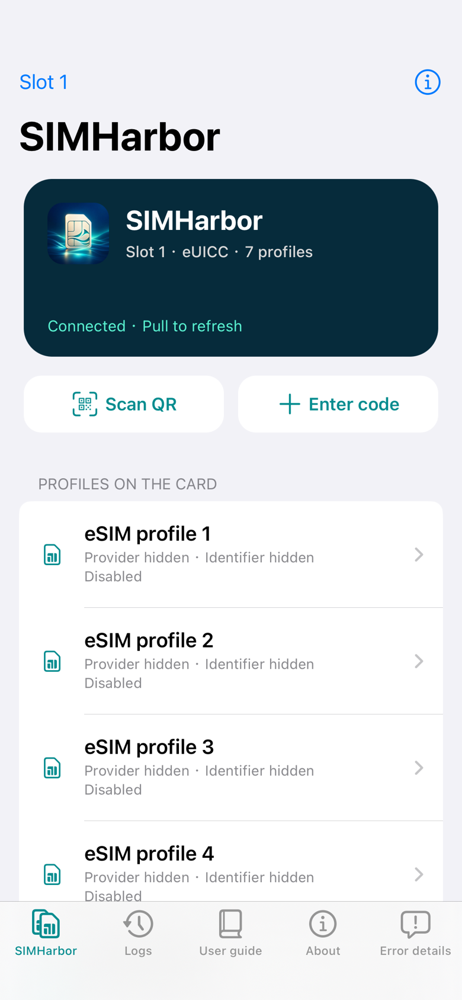
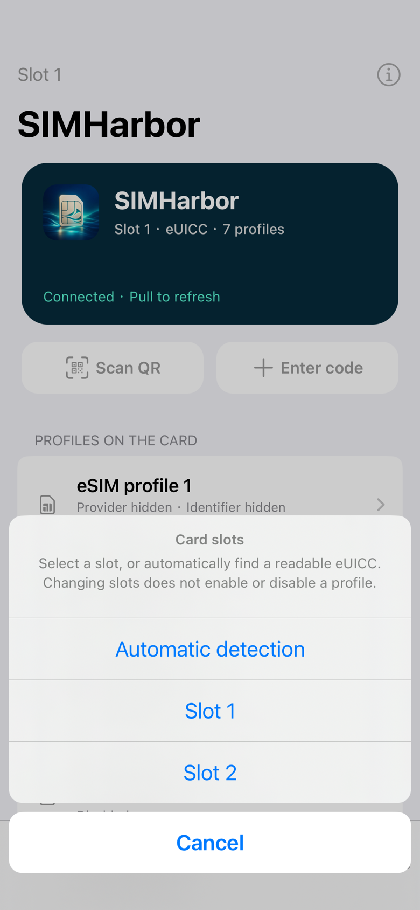
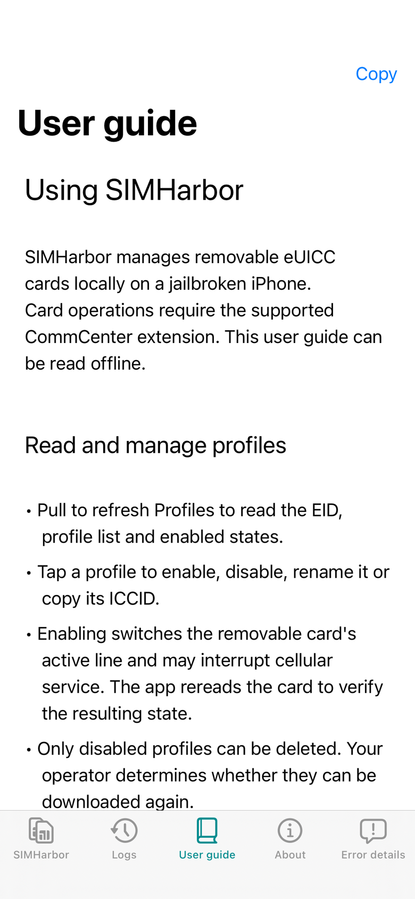
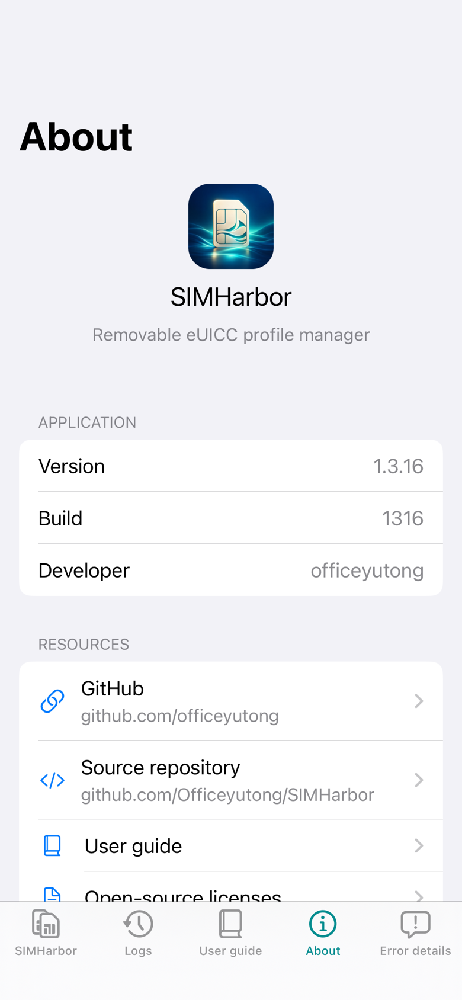

# SIMHarbor

**English** | [简体中文](README.zh-CN.md)

SIMHarbor (芯舟) is a native app and CommCenter extension for managing removable eUICC cards on jailbroken iPhones. Developed by [officeyutong](https://github.com/officeyutong).

Features include runtime slot discovery, automatic or manual card selection with EID identity checks, profile listing, downloading, enabling/disabling, renaming, deletion, notification management, camera and image QR scanning, continuous and tap-to-focus, English and Chinese interfaces, an offline user guide, a raw APDU/DER console, and an Error details tab that opens automatically for failed profile operations. Duplicate installs and other recognized failures have actionable messages; the details retain protocol diagnostics and support copying and clearing. Normal use requires neither a computer nor Frida server.

Compatibility is inferred at runtime by the Patchfinder, without a device-model, iOS-build or image-UUID allowlist. A complete, unique code plan and matching interface signatures enable transport hooks; live-object and slot validation must also pass before card commands. UUIDs are diagnostic metadata only. iPhone 13 / iOS 17.2.1 (21C66), roothide remains the device-tested baseline, not a prerequisite. Other firmware still needs validation. The app currently uses iOS 14+ UI APIs and an ARM64 transport adapter.

## Screenshots

English UI captured on an iPhone 13 running iOS 17.2.1. Profile names, providers and card identifiers are hidden for privacy.

| Profiles | Card slots |
| --- | --- |
|  |  |
| **User guide** | **About** |
|  |  |

## Build on Linux

The build uses Ubuntu 24.04, Clang 22, pinned roothide/Theos, SDK 16.5, and a legacy Darwin linker toolchain. Dependencies are downloaded into ignored directories. No device credentials, activation codes, or Apple developer signing certificates are required.

```sh
bash ci/install_linux_deps.sh
python3 ci/bootstrap.py
python3 scripts/sync_version.py
python3 tests/test_ci_policy.py
python3 tests/test_fetch_gum.py
python3 tests/test_packaging_tools.py
python3 tests/check_offline.py
bash build.sh
```

The default build produces a roothide deb in `packages/`. Set `SIMHARBOR_SCHEME=rootful`, `rootless`, or `roothide` to select a package. The same pinned roothide/Theos supports all three schemes, following the [roothide Developer README](https://github.com/roothide/Developer). See [package variants](docs/PACKAGING.md) for architectures, paths and verification commands. Packaging does not replace runtime compatibility checks.

Linux setup includes `libplist-utils` and its runtime dependency. Before compiling, the build exercises the `plistutil` selected by its toolchain PATH on XML and OpenStep `.strings` files, verifying binary conversion and Unicode values. Missing converter libraries are reported before compilation, including when reusing a cached toolchain.

Dependency sources, revisions, and checksums are recorded in `ci/dependencies.json` and `vendor/frida-gum/PROVENANCE.json`. Each build generates shared random IPC pairing material for its app and extension, then removes the generated header. Install the app and extension together from the same build.

## Automated builds and releases

GitHub Actions workflow: `.github/workflows/build.yml`.

- Every push, including all branches and tags, builds rootful, rootless and roothide packages in independent matrix jobs, each uploading its own artifact. Manual runs do the same. Successful builds include the deb and its scheme-specific SHA256 checksum and build metadata; failed builds upload available diagnostics. A failing variant does not cancel the others.
- A release tagged `vVERSION` is published only for a push to the default branch whose final `VERSION` differs from its value before that push. This also detects version changes followed by other commits within the same push.
- Introducing `VERSION` in the initial default-branch push counts as a version change and creates the first release. Changes only to code, documentation, or `BUILD_NUMBER` do not publish a release.
- Pushes to other branches, tag pushes, and manual runs do not publish releases. Existing releases are never overwritten. If the previous commit cannot be retrieved, the build and artifact upload proceed while publishing is disabled.
- Build jobs have read-only repository permissions. Only the separate release job receives `contents: write`. No custom token is required. Enable Actions in the repository; repository or organization policies may still restrict publishing.

Releases require all three variants to succeed. Assets include `SIMHarbor_VERSION_rootful.deb`, `SIMHarbor_VERSION_rootless.deb`, `SIMHarbor_VERSION_roothide.deb`, a combined `SHA256SUMS`, and per-scheme build metadata.

To release a new version, update `VERSION` and increment `BUILD_NUMBER` as needed. The package `control` file and app `Info.plist` are generated from templates in `packaging/`; they do not need manual synchronization. The current source version is 1.3.18 (build 1318). See the [release notes](docs/RELEASES.md).

## Tests and validation scope

On an authorized device, the installed executable's `--error-check` mode replays bilingual error fixtures, including an existing ICCID, insufficient space, an unspecified failure and an underlying network timeout. It checks that diagnostic snapshots survive later state replacement; it sends no card or network requests.

Local checks cover bilingual documentation and privacy, codecs, malformed inputs, real libeuicc mock-card flows, ASan/UBSan, and the CI release policy against real Git histories. See the [validation notes](docs/VALIDATION.md) for the scope of read-only device checks and full write tests. CI does not connect to a phone, download a real profile, or switch profiles.

Optional image-replay tests can be run with `python3 tests/check_resolver.py /path/to/resolver-fixture`. They require private images collected from an authorized device; these are excluded from the repository and CI.

## Documentation

The app includes only its bilingual user guide. Technical articles remain in this repository:

- [User guide](docs/manual/en/guide.md)
- [Multiple slots: discovery and routing](docs/MULTI_SLOT.md)
- [How the Patchfinder works](docs/PATCHFINDER.md)
- [App–CommCenter IPC protocol](docs/IPC.md)
- [Porting guide](docs/manual/en/porting.md)
- [Validation scope](docs/VALIDATION.md)

## Code formatting

Project-owned native sources use clang-format 22 and `.clang-format`; Python uses Ruff 0.17.3 and `pyproject.toml`; shell scripts use shfmt 3.12.0. With these tools (or `uv` for Ruff) on `PATH`, run `python3 scripts/format_code.py` to format, or add `--check` to verify. The script preserves Logos `%ctor` syntax. Vendored dependencies retain upstream formatting.

## Source layout

- `viewer/`: UIKit app, LPA, QR scanning, logs, a bilingual user guide, and About page.
- `tweak/`: CommCenter transport and Capstone/RTTI/call-graph resolution.
- `shared/`: IPC protocol and compiled transport-adapter layout checks.
- `docs/manual/`: the bundled English and Chinese user guide, plus repository-only technical articles.
- `ci/`: public dependency setup, release policy, and artifact verification.
- `vendor/`: third-party sources, licenses, and provenance. Gum devkit headers and libraries are downloaded and verified during the build.

This repository starts with a clean source history. It excludes device logs, research snapshots, historical packages, firmware, account credentials, activation information, and fixed pairing keys. Public hardware models, firmware UUIDs, technical offsets, and developer information are retained where relevant. `scripts/check_public_tree.py` checks files destined for Git; the documentation generator also checks documentation privacy.

## License

SIMHarbor's original code and documentation are licensed under the [MIT License](LICENSE), copyright © 2026 officeyutong.

Third-party components retain their respective licenses. Their notices and terms are included with the corresponding sources under `vendor/` and are available under About → Open-source licenses in the app. The project's MIT license does not replace third-party licenses, including libeuicc's LGPL-2.1 terms. SDKs and toolchains remain subject to their providers' terms.
