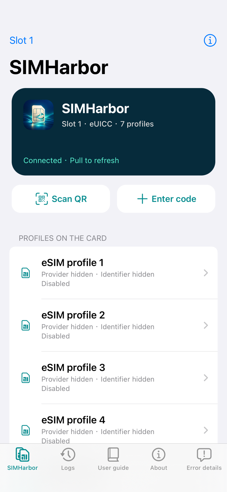
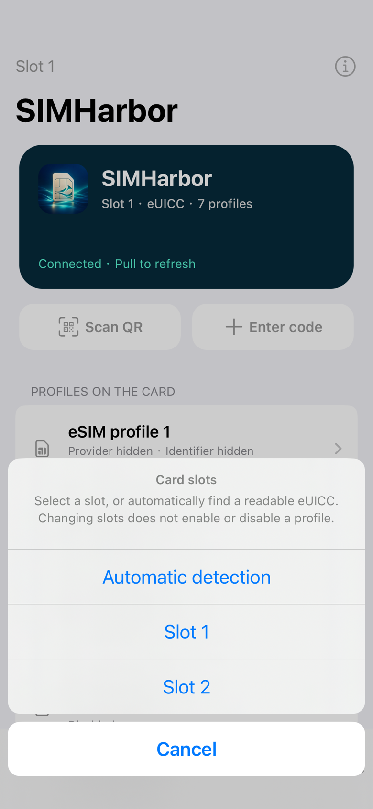
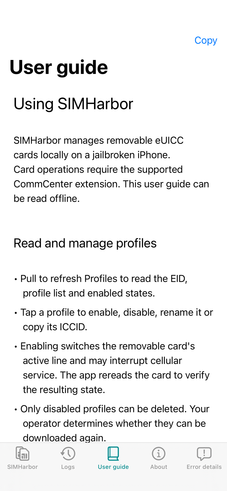
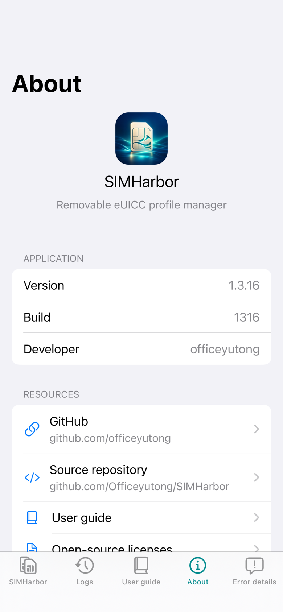

# 芯舟 · SIMHarbor

[English](README.md) | **简体中文**

在越狱 iPhone 上管理可移除 eUICC 的原生 App 与 CommCenter 扩展。开发者：[officeyutong](https://github.com/officeyutong)。

支持运行时卡槽发现、自动/手动选卡及 EID 身份核验、卡片列表、下载、启用/停用、昵称、删除、通知管理、二维码相机/图片识别、连续及点击对焦、中英文界面、离线使用说明和原始 APDU/DER 控制台。日常运行不需要电脑或 Frida server。

兼容性由 Patchfinder 在运行时推断，不再使用机型、iOS 构建或镜像 UUID 白名单。代码计划完整且唯一、接口签名匹配后安装通道 Hook；活对象和卡槽检查通过后才发送卡片命令。UUID 仅用于诊断。iPhone 13 / iOS 17.2.1（21C66）、roothide 是实测基线，不是运行前提；其他固件仍需验证。App 目前使用 iOS 14+ 界面 API 和 ARM64 通道适配器。

## 界面截图

以下为 iPhone 13 / iOS 17.2.1 上的英文界面实机截图。卡片名称、运营商及卡片标识已隐藏。

| 卡片列表 | 卡槽选择 |
| --- | --- |
|  |  |
| **使用说明** | **关于** |
|  |  |

## Linux 构建

使用 Ubuntu 24.04、Clang 22、固定版本 roothide/Theos、SDK 16.5 和旧版 Darwin 链接工具。依赖会下载到忽略目录，不需要设备账号、激活码或 Apple 开发者签名证书。

```sh
bash ci/install_linux_deps.sh
python3 ci/bootstrap.py
python3 scripts/sync_version.py
python3 tests/test_ci_policy.py
python3 tests/test_fetch_gum.py
python3 tests/test_packaging_tools.py
python3 tests/check_offline.py
bash build.sh
```

默认构建 roothide deb，输出在 `packages/`。通过 `SIMHARBOR_SCHEME=rootful`、`rootless` 或 `roothide` 选择方案。同一套固定版本 roothide/Theos 按 [roothide Developer README](https://github.com/roothide/Developer) 构建三种方案；架构、路径和校验命令见[安装包方案](docs/PACKAGING.md)。打包方案不能代替运行时兼容性检查。

Linux 依赖包含 `libplist-utils` 及其运行库。编译前会实际调用构建工具链 PATH 选中的 `plistutil`，转换 XML 与 OpenStep `.strings` 文件，并检查二进制格式和中文值。即使复用工具链缓存，缺少运行库也会在编译前直接报出。

公开依赖的来源、提交号和校验值见 `ci/dependencies.json` 与 `vendor/frida-gum/PROVENANCE.json`。构建时为 App 和扩展生成同一份随机 IPC 配对材料，构建结束删除头文件；不要拆开安装来自不同构建的 App 和扩展。

## 自动打包与发布

GitHub Actions 文件：`.github/workflows/build.yml`。

- 每次 push（所有分支和标签）和手动运行均独立构建 rootful、rootless、roothide，各上传一份 artifact。成功构建包含 deb、分方案 SHA256 和构建信息，失败构建上传已有诊断日志；某个方案失败不会取消其他方案。
- 仅默认分支的 push，且最终 `VERSION` 与该次 push 之前不同，才发布 `v版本号` release。一次 push 中间包含版本提交、最后还有其他提交，也能正确识别。
- 首次默认分支 push 引入 `VERSION` 视为版本变化，创建首个 release。仅修改代码、文档或 `BUILD_NUMBER` 不发布。
- 其他分支/tag push 和手动运行不发布；已有同名 release 不覆盖。无法取得旧提交时保留构建/artifact，停止自动发布。
- 普通构建只使用只读仓库权限；独立发布 job 才有 `contents: write`。不需要配置自定义 token。请允许仓库运行 Actions；仓库/组织策略仍可限制发布权限。

Release 要求三种构建全部成功，包含三个 `SIMHarbor_VERSION_方案.deb`、合并的 `SHA256SUMS` 以及各方案的构建信息。

发布新版时修改 `VERSION`，并按需递增 `BUILD_NUMBER`。`control` 和 App 的 `Info.plist` 从 `packaging/` 模板自动生成，无需手动同步。源码版本目前为 1.3.20（构建号 1320），变更见[版本记录](docs/RELEASES.md)。

项目自有运行时 JSON 使用 nlohmann/json 3.12.0，App/Tweak 共用类型化模型；libeuicc 保留上游 cJSON。版本及来源校验记录见 `vendor/nlohmann/PROVENANCE.json`。

## 测试与验证范围

配置操作失败时自动切换到「错误详情」页签，显示友好说明、失败阶段、协议错误码和响应，支持复制与清空。重复安装会按明确的卡片错误码提示使用已有配置；原因不明时保留具体诊断，不误报为重复安装。详情保留到本次运行结束或手动清空。

在授权设备上，可通过已安装可执行文件的 `--error-check` 模式回放双语错误样例，覆盖 ICCID 已存在、空间不足、原因不明及底层网络超时，并检查诊断快照不会被后续状态替换；此模式不发送卡片或网络请求。

已安装程序的 `--notification-check` 使用模拟卡片/网络方法验证自动通知默认值、关闭设置、成对切换事件、提交顺序及失败保留，不发送真实卡片或网络请求，并恢复测试时临时修改的设置。

本地检查覆盖双语文档/隐私、编解码、异常输入、真实 libeuicc 模拟卡端流程、ASan/UBSan，以及真实 Git 历史下的 CI 发布策略。只读设备测试与完整写入测试的适用范围见 [验证记录](docs/VALIDATION.md)。CI 不连接手机，不下载或切换真实 profile。

可选的镜像回放测试：`python3 tests/check_resolver.py /path/to/resolver-fixture`，需要自己从授权设备获取的私有镜像；这些数据不纳入仓库或 CI。

## VSCode 与 clangd

Linux Remote-SSH／Dev Container 环境中，安装与项目 Clang 22 配套的 `clangd-22`，仓库的 VSCode 设置会选择该程序。配置好 Theos 后，可用 `bear -- bash build.sh` 从真实构建生成仓库根目录的 `compile_commands.json`；SDK 或构建方案变更后重新生成，机器相关数据库不提交到 Git。

项目 `.clangd` 使用该数据库，并**仅对索引禁用隐式 SDK 模块**。Clang 支持 Objective-C 的 `#import`；“Could not build module Foundation” 可能源于更早的 Darwin/libc++ 模块错误，并非语法不支持。Clangd 18 还缺少此适配器所需的 `ptrauth.h`。编辑器专用 `SH_CLANGD` 标记只提供构建时生成的配对值的声明，不包含密钥，也不修改正式构建参数。

工作区将 `*.xm` 关联为 Objective-C++，`.clangd` 在借用其他文件编译命令时也指定相应语言和标准。当前启动文件使用与原 Logos `%ctor` 等价的原生构造函数，clangd 可以直接解析函数体；`%hook` 等 Logos 专用指令仍需要 Logos 预处理。

在 VSCode 中打开 SIMHarbor 仓库目录，在远端安装／启用 clangd 扩展，然后执行 **clangd: Restart language server**。若诊断仍存在，可在 clangd 输出窗口核对版本 22 及加载的编译数据库。官方说明：[clangd 配置](https://clangd.llvm.org/config)。

## 文档

App 仅内置双语使用说明，技术文章保留在仓库中：

- [使用说明](docs/manual/zh-Hans/guide.md)
- [多卡槽发现与路由](docs/MULTI_SLOT.zh-CN.md)
- [Patchfinder 是怎么工作的](docs/PATCHFINDER.zh-CN.md)
- [通过 CommCenter 内部函数与基带通信](docs/COMMCENTER_TRANSPORT.zh-CN.md)
- [共享 JSON 结构体与校验](docs/JSON_MODELS.zh-CN.md)
- [App 与 CommCenter 通信协议](docs/IPC.zh-CN.md)
- [移植指南](docs/manual/zh-Hans/porting.md)
- [验证范围](docs/VALIDATION.md)

## 源码与资料

项目自有原生源码使用 clang-format 22 和 `.clang-format`，Python 使用 Ruff 0.17.3 和 `pyproject.toml`，shell 使用 shfmt 3.12.0。工具加入 `PATH` 后，执行 `python3 scripts/format_code.py` 格式化，追加 `--check` 可检查；Ruff 也可由 `uv` 提供。脚本保留 Logos 的 `%ctor` 语法，第三方代码保留上游排版。

- `viewer/`：UIKit App、LPA、二维码、日志、双语使用说明、关于页。
- `tweak/`：CommCenter 通道、Capstone/RTTI/调用图定位。
- `shared/`：协议与通道适配器对象布局检查。
- `docs/manual/`：随包中英文使用说明，以及仅供仓库阅读的技术文章。
- `ci/`：公开依赖准备、版本发布策略、产物核对。
- `vendor/`：第三方源码、许可与来源说明；Gum devkit 的头/库在构建时经校验下载。

本仓库从清理后的源码建立新历史，不包含设备日志、研究快照、安装包历史、固件、账号凭据、激活信息或固定配对密钥。公开硬件型号、固件 UUID、技术偏移与开发者信息按用途保留。`scripts/check_public_tree.py` 检查将进入 Git 的文件，文档生成器另外检查文档隐私。

## 开源协议

SIMHarbor 自有代码和文档采用 [MIT License](LICENSE)，版权所有 © 2026 officeyutong。

第三方组件保留各自的许可证，声明及条款随 `vendor/` 下对应源码提供，并可在 App 的“关于 → 开源许可”中查看。项目的 MIT 协议不替代第三方许可证，包括 libeuicc 的 LGPL-2.1 条款。SDK 和工具链仍遵循其提供方条款。
