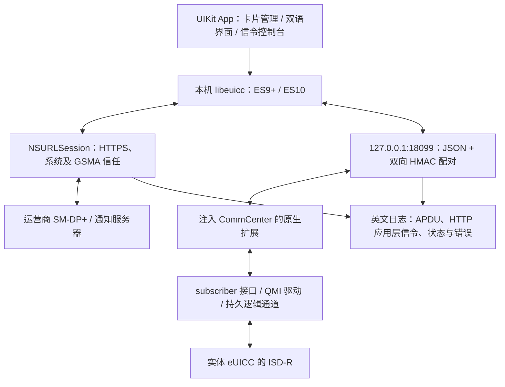

# 技术路线与移植

当前实际验证基线：iPhone 13（iPhone14,5）、iOS 17.2.1 / 21C66、roothide，历史验证中实体 eSTK eUICC 位于 slot 2；1.3.15 已在交换位置后验证动态选卡。1.1.4 完成了原生 测试条目 下载/重命名/启用/停用/恢复/删除回归；1.1.7 完成最终只读检查。1.2.1 已在真机完成文档/双语、日志和只读自定义信令验证。1.2.2 更新内置验证记录，传输核心未变。

## 当前路线

App 在手机本地执行 LPA，扩展只负责卡槽/逻辑通道/APDU。Frida 是研究和调试工具，普通使用不依赖它，也不需要电脑做 APDU 或 HTTP 中转。UI 操作共用串行队列，写卡、切换、读卡和自定义请求不会并发占用通道。

CommCenter 的高层 sender 接收的是 **AID**，不是任意原始 APDU。扩展借它建立 ISD-R 会话，拦截驱动准备关闭通道的流程以保持会话；后续替换驱动生成的 APDU 数据，捕获原始响应，再在 App 请求结束时关闭并释放原流程的回调。SIM 处于 inactive 状态时，改用驱动入口打开管理通道，支持停用后继续读卡或恢复线路。

App/扩展之间为有界 JSON 帧及随机挑战的双向 HMAC 认证，监听限于本机回环。HMAC 不隔离越狱 root；配对密钥随本项目的 App/扩展共同构建。扩展不再按机型、系统构建或 UUID 过滤；接口签名、代码计划、活对象及卡槽运行时检查通过后才开放卡片操作。

## 1.3 的运行时解析

扩展使用 Frida Gum 17.25.0 devkit 内的 Capstone 5 解码 ARM64；私有符号只在目标驱动模块中通过 CoreSymbolication 枚举。普通运行不需要 Frida server、JavaScript 或电脑。Hook 仍使用 Substrate。

解析分两步：先分析镜像得到 18 项代码位置/字段，再从只读的活对象识别 2 项字段。每项必须有唯一候选，报告保留来源与失败状态。没有旧数值偏移回退。卡片页的管理菜单提供「固件解析」，可以刷新和复制报告；读取报告本身不发送 APDU。

- Mach-O：运行时读取加载地址、代码段、UUID 和 LC_FUNCTION_STARTS；只接受目标镜像内的函数起点。
- 符号与调用关系：定位驱动打开/命令/关闭，通过 block 指令和调用图识别编码、响应、QMI 回调及其捕获字段。
- C++ RTTI 与虚表：查找 SubscriberSimController 和 APDU 闭包，再沿虚方法、worker、闭包构造关系确定 sender、worker、完成回调。
- 指令语义：从 worker 访问推导 SimInfo vector、逻辑槽字段和状态函数；就绪判断直接使用导出的 isSimReady，不固定状态枚举。
- 活对象：捕获导出的 Registry getter，有限遍历服务 map 的链，通过已识别虚表确认唯一控制器；无需旧 map/node/typeinfo/虚表槽偏移。
- 驱动指针必须精确匹配具体驱动 RTTI，排除名称中也包含驱动类的 shared_ptr 控制块。硬件槽字段在多个 SimInfo 节点中交叉验证，逻辑槽和硬件槽分别使用。

## 当前解析结果样本

下表是 iPhone14,5 / iOS 17.2.1 的研究样本，不是配置或跨版本常量；地址相对于各自镜像基址。完整实现位于 tweak/ResolverCore.cpp、tweak/RuntimeResolver.mm 和 tweak/Apdu.mm。

| 项目 | 本机构建的解析结果 |
|---|---|
| CommCenter UUID | 10bdb2fd04e33fcea0a188d064801df2 |
| 驱动 UUID | 571c9998ee7c3d9e946f779aee761332 |
| sender / worker | CommCenter +0x7e4568 / +0x7ff250 |
| 控制器虚表 / 完成回调 | CommCenter +0x175fb78 / +0x803a74 |
| SimInfo 状态函数 | CommCenter +0x11c3c10 |
| SimInfo vector / 逻辑槽 | 控制器 +0xa8 / SimInfo +0x24 |
| 驱动打开 / 命令 / 关闭 | 驱动 +0x168858 / +0x1693e0 / +0x16a7a4 |
| 编码 / QMI / 响应回调 | 驱动 +0x169bb8 / +0x16a214 / +0x16a43c |
| 编码通道 / 响应硬件槽 / 响应通道 | block +0x30 / +0x30 / +0x34 |
| QMI 错误字段 | 结果 +0x4 |
| 控制器驱动指针 / SimInfo 硬件槽 | 活对象 +0x68 / +0x20 |
| 就绪判断 / Registry | 导出的 subscriber::isSimReady 和 Registry::getServiceMap |

## 支持新版本的流程

1. 安装正常构建并保存运行时报告，记录设备、基带、架构及 UUID 供诊断。未知 UUID 走同一套发现流程，不需要修改批准表。
2. 若代码位置能唯一解析，重点核对私有函数签名、参数顺序、C++ 按值/引用传递、block 捕获语义、回调生命周期和 PAC。当前编译实测 shared_ptr 为 16 字节、std::function 为 32 字节；早期 Frida 脚本分配的 48 字节不是该类型 sizeof。对象大小相同也不能证明 ABI 一样。
3. 不再存在 UUID 批准表。解析失败时，根据报告更新对应语义规则或适配器，并添加镜像回放和反例；不要回退旧数值偏移或强制标记计划完成。
4. 核对注入环境、arm64/arm64e、Substrate 及 rootless/roothide 打包。先只读核对活对象、逻辑/硬件槽映射、Get EID、列表、61xx、关闭通道及断连恢复。
5. 再使用已授权且可重新下载的测试 profile，验证下载、启用、停用、恢复和删除，并逐项比较基线。1.3.15 起动态枚举已分配逻辑卡槽，并提供自动/手动选卡；逻辑编号不代表所有设备的实体卡槽位置。
6. 单独测试网络权限、GSMA TLS、相机/相册、前后台与重启。App 的标准 LPA/UI 通常可复用；内部 eUICC、MEP、不同基带和 USB 读卡器需要另做通路适配。

是否启用通道由运行时证据决定，不取决于固件身份。符号缺失、RTTI 被裁剪、签名或指令改变、对象候选不唯一都会拒绝操作并保留诊断。活对象算法接受 1–16 个 SimInfo 节点，要求唯一的 1–3 硬件槽字段；单节点仍可能存在无法区分的候选。不同映射需要扩展规则并实测，检查通过也不是对私有 ABI 的形式化证明。

## 资源和验证约束

CommCenter 的内存限额很低。早期全进程 Gum 符号枚举触发内存高水位终止，已回退并移除；最终使用模块级 CoreSymbolication，显式注册 Capstone ARM64 和 libc 分配函数，避免 Gum/GLib 全局缓存。报告中的 maxMeasuredFootprintBytes 是若干阶段的采样最大值，不是连续测得的进程峰值。解析失败显式返回错误，不依赖 C++ 异常展开。

新解析器需要重新完成写卡/切换回归；本轮只读验证不能替代先前 1.1.4 的完整写入测试，也不能证明其他系统兼容。

## 1.2.0 日志与自定义请求

- 英文 UTC 日志记录 App 实际发出的 APDU、接收字节及 SW；HTTP 记录 URL、方法、应用层请求/响应头、状态码和完整 body 的分块十六进制。它不是抓取全机流量，也不包含 TLS 加密记录或 App 无法看到的基带内部信令。
- TX 表示 App 的发送尝试，RX 才是回读；超时不能证明卡端未执行命令。
- 日志保留在内存，约 4 MiB 后淘汰旧记录并显示计数。导出创建 `.log` 文件；原始 body 可能含 MatchingID、证书、加密包和卡片标识，不能再假设日志没有激活凭据。
- 原始 APDU：每行一条，最多 64 条；支持短 APDU，输入基本通道 CLA，按实际通道绑定。不自动重试或处理 61xx/6Cxx；默认遇到非 9000 状态停止，关闭开关后可自行编排 GET RESPONSE。
- ES10 DER：一个完整 TLV，使用现有库按 MSS 分块并收集 61xx；不提供任意 HTTP 请求功能。限制为最多 256 块、4096 次传输和 1 MiB 响应；此模式保留库现有的通道编码，暂限通道 0–3，避免在未验证的高通道号上发错 CLA。
- 信令控制台仍限定已核对固件、实体卡和标准 ISD-R AID。命令可修改或删除卡片，因此每次提交前确认；没有自动执行示例或自动重发写命令。
- 中英文 UI：`viewer/Resources/{en,zh-Hans}.lproj`；默认跟随系统，也可在卡片设置中选择语言。日志和原始响应标签不随 UI 翻译。

离线检查入口：`python3 tests/check_offline.py`。它验证编解码、语言资源和 libeuicc 模拟卡端流程；无法验证新的 UIKit 页面、真实私有 ABI、卡片状态变化或运营商业务。
