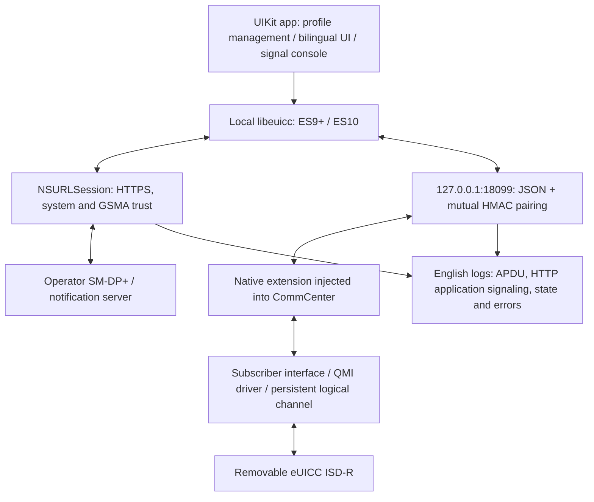

# Architecture and porting

**English** | [简体中文](ARCHITECTURE_PORTING.zh-CN.md)

The device-validated baseline is iPhone 13 (iPhone14,5), iOS 17.2.1 / 21C66 and roothide. The removable eSTK eUICC historically occupied slot 2; version 1.3.15 validated dynamic selection after swapping cards. Version 1.1.4 completed authorized test-profile download, rename, enable, disable, restore and deletion; 1.1.7 completed final read-only checks. Version 1.2.1 validated documentation/languages, logging and read-only custom signals on device. Version 1.2.2 updated the bundled validation record without changing the transport core.

## Current architecture

The app runs the LPA locally; the extension handles slots, logical channels and APDUs. Frida is a research/debugging tool, with no normal-use dependency or computer relay for APDU/HTTP traffic. UI operations share a serial queue so installation, switching, reads and custom requests do not use the channel concurrently.

CommCenter's high-level sender accepts an **AID**, not arbitrary raw APDU bytes. The extension uses it to establish ISD-R, intercepts automatic channel closing to retain the session, then replaces the driver's encoded APDU and captures raw responses. At the end of app requests it closes the channel and releases callbacks from the original flow. For an inactive SIM, the independent-command adapter can open management through the driver directly, allowing reads or line recovery after disabling a profile. The native-continuation adapter added in 1.3.22 currently requires a ready SIM; see [Patchfinder](PATCHFINDER.md).

App/extension communication uses bounded JSON frames and random-challenge mutual HMAC authentication on loopback only. HMAC does not isolate a jailbreak root user. The paired app/extension share a build-generated key. The extension has no device, OS-build or UUID filter; interface signatures, code plans, live objects and slot checks must pass at runtime before card operations become available.

## Runtime discovery in 1.3

The extension uses Capstone 5 from the Frida Gum 17.25.0 devkit for ARM64 decoding. CoreSymbolication enumerates private symbols only in the target driver module. Normal operation does not need Frida server, JavaScript or a computer. Hooks still use Substrate.

Discovery has two stages: image analysis supplies code locations/fields, followed by read-only live-object inspection for two additional fields. Each result must be unique, with sources and failure states recorded. There is no fallback to old numerical offsets. The card management menu offers Firmware Resolver with refresh/copy; reading the report sends no APDU. Version 1.3.22 also discovers the container representation/stride and handles native command continuations.

- Mach-O: read runtime load addresses, code ranges, UUIDs and LC_FUNCTION_STARTS; accept function starts only in the owning target image.
- Symbols/call relationships: find driver open/command/close, then identify encoder, response and QMI callbacks and captured fields through block instructions and call graphs.
- C++ RTTI/vtables: identify SubscriberSimController and APDU closures; follow virtual-method, worker and closure-construction relationships to recover sender, worker and completion.
- Instruction semantics: derive the SimInfo container, logical-slot field and state getter from worker accesses. Readiness uses the exported isSimReady predicate rather than a fixed state enum.
- Live objects: capture exported Registry getters, follow bounded service-map chains and match the discovered vtable to one controller. Old map/node/typeinfo/virtual-slot offsets are unnecessary.
- The driver pointer must match the concrete driver's RTTI exactly, excluding shared_ptr control blocks that contain the driver class name. Hardware-slot fields are cross-checked across SimInfo nodes; logical and hardware slots remain distinct.

## Example discovery results

This table describes the iPhone14,5 / iOS 17.2.1 research sample, not configuration or cross-version constants. Addresses are relative to their own image base. Implementation: tweak/ResolverCore.cpp, tweak/RuntimeResolver.mm and tweak/Apdu.mm.

| Result | Locally discovered value |
|---|---|
| CommCenter UUID | 10bdb2fd04e33fcea0a188d064801df2 |
| Driver UUID | 571c9998ee7c3d9e946f779aee761332 |
| Sender / worker | CommCenter +0x7e4568 / +0x7ff250 |
| Controller vtable / completion | CommCenter +0x175fb78 / +0x803a74 |
| SimInfo state getter | CommCenter +0x11c3c10 |
| SimInfo vector / logical slot | Controller +0xa8 / SimInfo +0x24 |
| Driver open / command / close | Driver +0x168858 / +0x1693e0 / +0x16a7a4 |
| Encoder / QMI / response | Driver +0x169bb8 / +0x16a214 / +0x16a43c |
| Encoder channel / response hardware slot / response channel | Block +0x30 / +0x30 / +0x34 |
| QMI error | Result +0x4 |
| Controller driver pointer / SimInfo hardware slot | Live objects +0x68 / +0x20 |
| Readiness / Registry | Exported subscriber::isSimReady and Registry::getServiceMap |

## Supporting another version

1. Install a normal build and save its runtime report, recording device, baseband, architecture and UUIDs for diagnosis. Unknown UUIDs follow the same discovery process without an approval-table change.
2. If code resolves uniquely, verify private signatures, argument order, C++ value/reference passing, block captures, callback lifetimes and PAC. The compiled shared_ptr measures 16 bytes and std::function 32 bytes; the 48 bytes allocated by early Frida scripts were not sizeof that type. Equal sizes do not prove ABI equivalence.
3. There is no UUID approval table. On failure, update the relevant semantic rule/adapter and add image replay and negative cases. Do not restore old numerical offsets or force a complete plan.
4. Check injection, arm64/arm64e, Substrate and rootless/roothide packaging. Start with read-only live objects, logical/hardware mappings, Get EID, profile listing, 61xx, channel close and disconnect recovery.
5. Then use an authorized, redownloadable test profile for download, enable, disable, restore and deletion, comparing the baseline at each step. Since 1.3.15, assigned logical slots are dynamically enumerated with automatic/manual selection; a logical ID does not universally identify a physical position.
6. Separately test network permissions, GSMA TLS, camera/photos, foreground/background and reboot. The standard LPA/UI can usually be reused; internal eUICCs, MEP, other basebands and USB readers need separate transport adapters.

Runtime evidence determines channel eligibility. Missing symbols, stripped RTTI, changed signatures/instructions or ambiguous objects reject operations with diagnostics. Live discovery accepts 1–16 SimInfo nodes and requires one distinct hardware-slot field in the range 1–3; one node may leave indistinguishable candidates. Other mappings need new rules and device testing. Passing checks is not a formal proof of the private ABI.

## Resource and validation limits

CommCenter has a low memory budget. Early process-wide Gum symbol enumeration triggered high-watermark termination and was removed. Production uses module-scoped CoreSymbolication, explicit Capstone ARM64 registration and libc allocation callbacks, avoiding global Gum/GLib caches. maxMeasuredFootprintBytes is the largest phase sample, not a continuously measured peak. Discovery errors are returned explicitly without relying on C++ exception unwinding.

The new resolver still needs full write/switch regression. Read-only checks do not replace the historical 1.1.4 write tests or establish support for other systems.

## Logging and custom requests introduced in 1.2.0

- English UTC logs record APDUs attempted by the app, received bytes and SW. HTTP logs contain URL, method, application request/response headers, status and complete bodies as chunked hex. They do not capture all device traffic, TLS records or baseband-internal signaling unavailable to the app.
- TX means an app send attempt; RX records a response. A timeout does not prove the card did not execute a command.
- Logs stay in memory, evicting old records after approximately 4 MiB with a counter. Export creates a `.log` file. Bodies may contain MatchingID, certificates, encrypted packages and card identifiers; do not assume logs exclude activation credentials.
- Raw APDU: one per line, up to 64; short APDUs with a basic-channel CLA mapped to the actual channel. No automatic retry or 61xx/6Cxx handling. Non-9000 stops by default; disabling that setting permits explicit GET RESPONSE sequences.
- ES10 DER: one complete TLV, split by MSS through the existing library and collecting 61xx. Arbitrary HTTP requests are not provided. Limits are 256 blocks, 4096 transmissions and a 1 MiB response. Existing library channel encoding currently limits this mode to channels 0–3 to avoid unverified high-channel CLA values.
- The signal console remains scoped to runtime-validated firmware, removable cards and the standard ISD-R AID. Commands can change/delete card contents and require confirmation before submission. Examples are not executed automatically and writes are not automatically replayed.
- Bilingual UI resources: `viewer/Resources/{en,zh-Hans}.lproj`. Language follows the system by default and can be selected in card settings. Logs and raw-response labels remain English.

Offline checks: `python3 tests/check_offline.py`. These cover codecs, language resources and libeuicc mock-card flows, excluding new UIKit views, actual private ABIs, card state changes and operator services.
