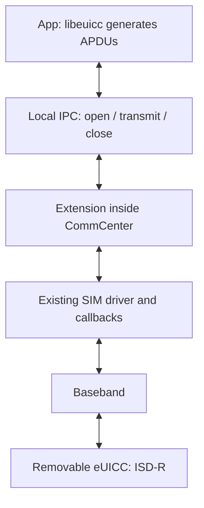
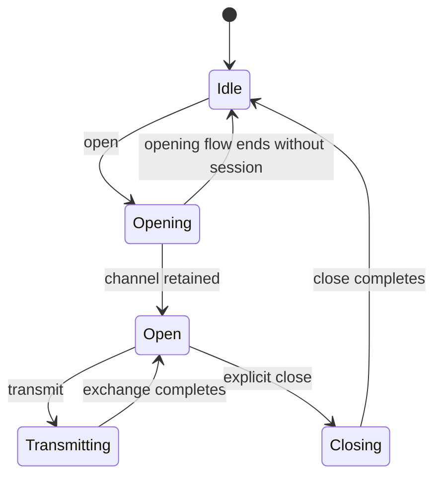

# How SIMHarbor communicates with the baseband through CommCenter

**English** | [简体中文](COMMCENTER_TRANSPORT.zh-CN.md)

This document describes the native transport implemented in [Apdu.mm](../tweak/Apdu.mm). It explains how existing CommCenter controller/driver entry points and hooks provide a persistent APDU session to a removable eUICC. These are private interfaces discovered by reverse engineering, not a public Apple API or a specification for every modem.

## Responsibilities and boundaries

The app runs libeuicc to implement the eSIM management protocols. Its APDU adapter sends `open`, `transmit` and `close` requests to the extension inside CommCenter over authenticated local IPC. The extension uses CommCenter's existing SIM driver; that driver handles the underlying baseband-message construction, delivery and asynchronous callbacks. The baseband performs the exchange with the card.



Operator HTTPS requests run separately in the app. The transport carries APDUs and does not itself download, decrypt or install a profile package. libeuicc orchestrates the standard exchanges; the eUICC processes the protected package. See [IPC](IPC.md) for framing/authentication and [architecture](manual/en/architecture.md) for the wider flow.

## 1. Resolve code and obtain live objects

Calling a private C++ method requires a compatible function address **and a valid object pointer**. An address by itself is insufficient.

The Patchfinder discovers the controller vtable, sender, driver methods, callbacks and required field offsets. `estk_apdu_start` installs hooks with Substrate's `MSHookFunction` after the code plan and compiled-adapter/signature checks pass. The saved `*Orig` pointers call the original implementations through the hook machinery.

Hooks on exported Registry getters capture the service-map pointer. `ensureInterface` uses bounded object discovery to locate the unique live `SubscriberSimController` matching the resolved vtable. Live-object inspection also identifies the concrete `subscriber::EURSimCommandDriver` member and hardware-slot field. Card operations require valid objects and slot mappings as well as resolved code.

The app supplies a logical slot ID. `slotInfo` maps it through the current SimInfo entries to the hardware slot used by driver calls. Unassigned nodes are excluded from selectable slots. Logical and hardware IDs must remain distinct. See [multiple slots](MULTI_SLOT.md).

The `signedFn` helper constructs signed function pointers when invoking resolved entry points. Correct C++/block layouts, argument passing and callback lifetimes remain necessary; pointer signing does not establish ABI compatibility. The discovery rules and per-offset purposes are documented in [Patchfinder](PATCHFINDER.md).

## 2. Open the card's management application

The bridge accepts the ISD-R AID `a0000005591010ffffffff8900000100`. An AID identifies an application on the card; it is not a command APDU.

There are two opening paths:

| SIM state | Path | Session information |
|---|---|---|
| Ready according to the discovered state getter and exported `isSimReady` predicate | Call the controller's `sender` with the logical slot, shared AID/output vectors and completion callback. | During opening, `commandHook` observes the matching hardware slot and captures the driver `this` pointer, channel and response-vector reference. |
| Not ready | Read the validated driver member and directly call `sendSimApdu_start` with the hardware slot and AID. | A supplied opened block records the channel. The extension owns a response vector and supplies its own completion callback. |

The high-level `sender` receives the AID, **not arbitrary raw APDU bytes**. The separate command/encoder path described below enables arbitrary management APDUs. A modem-ready SIM does not prove eUICC support; opening ISD-R can still fail.

The second path allows management attempts when an active cellular profile is unavailable. Its availability depends on runtime validation and the card/driver, not a guarantee that every inactive SIM can be accessed.

## 3. Retain the session instead of closing after one exchange

The original driver flow calls `sendSimApdu_close` when its exchange finishes. Closing at that point would prevent a multi-command eSIM transaction from using the same session.

`closeHook` checks the driver object, hardware slot and channel while the bridge is opening or transmitting. For the matching session, it retains the completion callback if needed, changes the phase to open and signals the waiting request instead of calling the original close function. Other close calls pass through.

On the normal sender path, the retained callback keeps the original completion flow available. The saved response-vector pointer relies on that session's lifetime; it is not an independently owned vector. The direct path instead retains its own `shared_ptr` response vector and completion function. These objects must remain valid until explicit close and cleanup.

## 4. Trigger the driver command and substitute its encoded bytes

For `transmit`, the extension validates a 4–261-byte APDU, stores it in `pending`, clears the previous response/error and enters the transmitting phase. The current implementation then calls:

```cpp
commandOrig(driver, slot, channel, 0xc0, *responseVector, retained);
```

Here `slot` is the hardware ID. This invokes the saved original `sendSimApdu_command` implementation. **The `0xc0` argument triggers the existing command path; it does not mean that every user command becomes GET RESPONSE.** The encoded bytes are subsequently replaced.

`encodeHook` first calls the original encoder. When the bridge is transmitting and the captured channel matches, it replaces the generated byte vector with `pending` and consumes that pending buffer. Conceptually:

```cpp
encodeOrig(block, bytes);
// After the phase/channel checks and under the bridge mutex:
bytes = pending;
pending.clear();
```

This is the point where the app's actual APDU enters the driver's outgoing exchange. It can therefore carry a STORE DATA command, GET RESPONSE or another APDU produced by libeuicc. The driver continues handling the lower-level baseband transport.

## 5. Capture response data and complete the waiting request

| Hook | Current behavior |
|---|---|
| `responseHook` | While transmitting, match the captured hardware slot and channel, copy the raw response vector into `raw`, then call the original response callback. The bytes include SW1/SW2. |
| `qmiHook` | While transmitting, read the discovered transport-result field into `qmiError`, then call the original callback. Its current guard is the phase, without a separate slot/channel check. |
| `closeHook` | Defer a matching automatic close, transition back to open and signal the semaphore. |
| `completionHook` | Call the original high-level completion handler, then signal explicit-close completion or an opening flow that ended without a retained session. |

The direct path also has its own completion function to signal transmission/closing state changes. `awaitDone` waits up to 25 seconds per wait. After transmission completes, a nonzero `qmiError` or a response shorter than two bytes produces a transport failure. Otherwise the full response is returned to the app as hex.

These error layers are separate:

- The baseband/driver result indicates whether the transport exchange succeeded.
- APDU SW1/SW2 describe the card command result or required continuation. For example, `6115` requests collection of 21 more response bytes.
- An ES10b installation result describes profile-installation success or rejection inside the response payload.

libeuicc's DER path handles command fragmentation and `61xx` response collection. The raw APDU console preserves explicit user commands and does not silently resend them or fetch continuations.

## 6. Explicitly close and release the session

An app `close` request calls `closeSession`. From the open state it changes the phase to closing and calls `closeOrig(driver, slot, channel, true, retained)`. Calling the original pointer allows the real close to proceed instead of being deferred again by the hook.

After completion is signalled, the extension releases the retained callback and direct response ownership, clears driver/vector pointers and resets the channel. The high-level completion hook or the direct-path completion function signals the relevant closing flow.



Internally, `std::atomic<Phase>` uses `enum class Phase : int`: `Idle = 0`, `Opening = 1`, `Open = 2`, `Transmitting = 3`, `Closing = 4`. Status/slot replies explicitly convert the enum to an integer, preserving those IPC values. This diagram describes completed transitions; a timeout is not proof that the state returned to idle or that a card command did not execute. The bridge does not automatically replay a timed-out write. Socket disconnects trigger cleanup attempts as described in [IPC recovery](IPC.md#state-timeouts-and-recovery).

## Implementation limits

- The bridge retains one global session. The app shares a serial operation queue across LPA engines; multi-slot support means selecting a target, not parallel independent APDU channels.
- Filtering differs by hook: response capture uses slot plus channel, the encoder checks channel, and QMI-result capture currently checks phase only. Serialization does not formally prove isolation from every unrelated modem activity.
- The implementation relies on private driver signatures, C++/block ABI and live-object layouts. Runtime discovery rejects missing or ambiguous evidence, but passing those checks does not prove compatibility with every firmware.
- The supported transport target is a removable eUICC in the SIM path. This implementation does not establish access to the iPhone's built-in eUICC or arbitrary modem functions.
- Frida was used during research and remains useful for debugging. Normal operation uses the native extension, Substrate hooks and Capstone-based discovery without a Frida server.

For a code reading, start at `handle`'s `open` / `transmit` branches and `closeSession`, then follow `commandHook`, `encodeHook`, `responseHook`, `qmiHook`, `closeHook` and `completionHook` in [Apdu.mm](../tweak/Apdu.mm). Function discovery is in [ResolverCore.cpp](../tweak/ResolverCore.cpp); runtime object inspection is in [RuntimeResolver.mm](../tweak/RuntimeResolver.mm).
