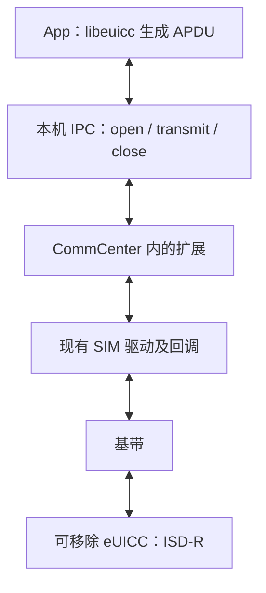
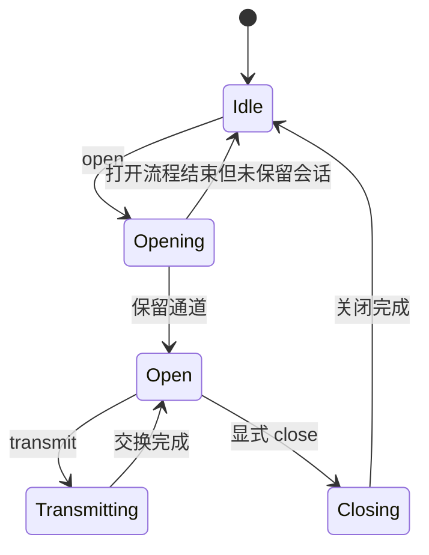

# SIMHarbor 如何通过 CommCenter 内部函数与基带通信

[English](COMMCENTER_TRANSPORT.md) | **简体中文**

本文对应 [Apdu.mm](../tweak/Apdu.mm) 中的原生传输实现，说明项目如何调用 CommCenter 已有的控制器／驱动入口，结合 Hook 为可移除 eUICC 提供持久 APDU 会话。这些是逆向得到的私有接口，并非 Apple 公开 API，也不是适用于所有基带的接口规范。

## 职责与边界

App 使用 libeuicc 实现 eSIM 管理协议，其 APDU 适配层通过经过认证的本机 IPC，向 CommCenter 内的扩展发送 `open`、`transmit` 和 `close`。扩展调用已有 SIM 驱动，由系统驱动继续负责底层基带消息的封装、投递和异步回调，再由基带完成与卡片的交换。



运营商 HTTPS 请求另行在 App 中执行。这一传输层承载 APDU，本身不负责下载、解密或安装配置包；libeuicc 组织标准协议交互，eUICC 处理受保护的配置包。报文及认证见 [IPC 文档](IPC.zh-CN.md)，整体流程见[技术路线](manual/zh-Hans/architecture.md)。

## 1. 定位代码并取得真实对象

调用 C++ 私有成员函数，需要兼容的函数地址和**有效的对象指针**，只有地址还不够。

Patchfinder 发现控制器虚表、sender、驱动方法、回调及所需字段偏移。代码计划、编译适配器／接口签名检查通过后，`estk_apdu_start` 使用 Substrate 的 `MSHookFunction` 安装 Hook。保存的 `*Orig` 指针用于经过 Hook 机制调用原始实现。

Registry 导出 getter 的 Hook 捕获服务 map 指针；`ensureInterface` 再做有界对象发现，定位虚表匹配且唯一的活 `SubscriberSimController`。活对象检查还识别具体 `subscriber::EURSimCommandDriver` 成员和硬件槽字段。代码解析通过后，卡片操作仍需要有效对象及卡槽映射。

App 提供逻辑卡槽编号，`slotInfo` 遍历当前 SimInfo，映射成驱动使用的硬件卡槽。未分配节点不作为可选卡槽；逻辑编号和硬件编号必须分别处理，详见[多卡槽文档](MULTI_SLOT.zh-CN.md)。

调用解析入口时，`signedFn` 构造带签名的函数指针；正确的 C++／block 布局、参数传递和回调生命周期仍是必要条件，指针签名本身不能证明 ABI 兼容。定位规则及每项偏移的用途见 [Patchfinder 文档](PATCHFINDER.zh-CN.md)。

## 2. 打开卡片管理应用

桥接层只接受 ISD-R AID `a0000005591010ffffffff8900000100`。AID 标识卡片中的应用，并不是命令 APDU。

打开通道有两条路径：

| SIM 状态 | 调用路径 | 取得的会话信息 |
|---|---|---|
| 发现的状态 getter 与导出的 `isSimReady` 判断为就绪 | 调用控制器 `sender`，传入逻辑槽、共享 AID／输出 vector 及完成回调。 | 打开期间，`commandHook` 在硬件槽匹配时捕获驱动 `this` 指针、通道号和响应 vector 引用。 |
| 未就绪 | 读取经过验证的驱动成员，直接调用 `sendSimApdu_start`，传入硬件槽和 AID。 | 提供的 opened block 记录通道号；扩展自行持有响应 vector，并提供完成回调。 |

高层 `sender` 接收的是 AID，**不是任意原始 APDU**；下文的命令／编码路径才实现目标 APDU 的发送。基带报告 SIM 就绪也不证明它支持 eUICC，打开 ISD-R 仍可能失败。

第二条路径允许在没有可用蜂窝配置时尝试管理卡片，但是否可用仍取决于运行时验证、卡片和驱动，不代表所有未激活 SIM 都能访问。

## 3. 保留会话，暂缓一次交换后的自动关闭

原驱动流程会在交换结束时调用 `sendSimApdu_close`。若此时直接关闭，多条命令组成的 eSIM 事务便无法继续使用该会话。

`closeHook` 在打开／传输阶段核对驱动对象、硬件槽和通道。命中当前会话时，按需保留完成回调，将阶段改回已打开并唤醒等待请求，暂不调用原始关闭函数；其他关闭请求继续交给原实现。

普通 sender 路径保留原始完成回调，让原任务的结束流程仍然可用。保存的响应 vector 指针依赖这个会话的生命周期，不是独立拥有的 vector。直接路径则自行持有 `shared_ptr` 响应 vector 和完成函数。这些对象必须在显式关闭与清理前保持有效。

## 4. 触发驱动命令，在编码阶段换入目标 APDU

处理 `transmit` 时，扩展检查 APDU 长度为 4～261 字节，将其存入 `pending`，清空上一条响应／错误，并进入传输阶段。当前代码随后调用：

```cpp
commandOrig(driver, slot, channel, 0xc0, *responseVector, retained);
```

其中 `slot` 是硬件编号。这会调用保存的原始 `sendSimApdu_command`。**`0xc0` 用于触发已有命令流程，不代表用户命令全部变成 GET RESPONSE**；后续还会替换编码结果。

`encodeHook` 先执行原始编码函数；处于传输阶段且捕获的通道匹配时，用 `pending` 替换生成的字节 vector，并消费待发缓冲。可以概括为：

```cpp
encodeOrig(block, bytes);
// 通过阶段／通道检查，并持有桥接层互斥锁后：
bytes = pending;
pending.clear();
```

这就是 App 的实际 APDU 进入驱动出站交换的位置，因此既能发送 STORE DATA，也能发送 GET RESPONSE 或 libeuicc 产生的其他 APDU。下层基带传输仍由系统驱动完成。

## 5. 捕获响应并完成等待中的请求

| Hook | 当前行为 |
|---|---|
| `responseHook` | 传输期间核对捕获的硬件槽和通道，将包含 SW1/SW2 的原始响应 vector 复制到 `raw`，再调用原始响应回调。 |
| `qmiHook` | 传输期间从发现的结果字段读取基带传输结果到 `qmiError`，再调用原回调；目前只检查阶段，没有额外的槽位／通道检查。 |
| `closeHook` | 暂缓匹配的自动关闭，恢复已打开阶段，并通过信号量唤醒等待方。 |
| `completionHook` | 先调用原始高层完成函数，再通知显式关闭完成，或通知未保留会话的打开流程已经结束。 |

直接路径也有自己的完成函数，用于通知传输／关闭阶段变化。`awaitDone` 每次最多等待 25 秒。传输结束后，若 `qmiError` 非零或响应不足两个字节，返回传输失败；否则将完整响应编码为十六进制，返回 App。

这里有三个不同的错误层次：

- 基带／驱动结果：传输交换本身是否成功。
- APDU SW1/SW2：卡片命令的结果或后续处理要求，例如 `6115` 表示还有 21 字节响应待取。
- ES10b 安装结果：响应内容中报告的 profile 安装成功或拒绝原因。

libeuicc 的 DER 路径负责请求分块和 `61xx` 后续响应收集；原始 APDU 控制台保留用户明确输入的命令，不静默重发或续取。

## 6. 显式关闭并释放会话

App 发送 `close` 后，`closeSession` 从已打开阶段进入关闭阶段，调用 `closeOrig(driver, slot, channel, true, retained)`。这里使用原始函数指针，使真正关闭继续执行，而不会再次被 Hook 暂缓。

完成信号到达后，扩展释放保留回调及直接路径的响应所有权，清空驱动／vector 指针并重置通道。高层完成 Hook 或直接路径的完成函数负责通知相应的关闭流程结束。



内部使用 `std::atomic<Phase>`，类型为 `enum class Phase : int`：`Idle = 0`、`Opening = 1`、`Open = 2`、`Transmitting = 3`、`Closing = 4`。状态／卡槽回复显式转换为整数，保持 IPC 编码不变。图中描述完成的状态迁移；超时不代表已经回到空闲，也不证明卡片没有执行命令。桥接层不会自动重放超时写入。socket 断连会触发清理尝试，详见 [IPC 状态与恢复](IPC.zh-CN.md#状态超时与恢复)。

## 当前实现边界

- 桥接层只保留一个全局会话，App 的各 LPA 实例共用串行队列。多卡槽支持表示选择目标卡槽，不是并行管理多条独立 APDU 通道。
- 各 Hook 的筛选条件不同：响应使用硬件槽和通道，编码检查通道，QMI 结果当前只检查阶段。串行化不构成与所有其他基带活动隔离的形式化证明。
- 实现依赖私有驱动签名、C++／block ABI 和活对象布局。运行时发现会拒绝缺失或歧义证据，但检查通过不能证明兼容所有固件。
- 当前传输目标是 SIM 通路上的可移除 eUICC；这些实现不代表已经支持 iPhone 内置 eUICC 或任意基带功能。
- Frida 用于早期研究和调试；日常运行使用原生扩展、Substrate Hook 和基于 Capstone 的发现，不需要 Frida server。

阅读代码时，可从 [Apdu.mm](../tweak/Apdu.mm) 中 `handle` 的 `open`／`transmit` 分支及 `closeSession` 开始，再依次看 `commandHook`、`encodeHook`、`responseHook`、`qmiHook`、`closeHook`、`completionHook`。函数发现位于 [ResolverCore.cpp](../tweak/ResolverCore.cpp)，运行时对象检查位于 [RuntimeResolver.mm](../tweak/RuntimeResolver.mm)。
