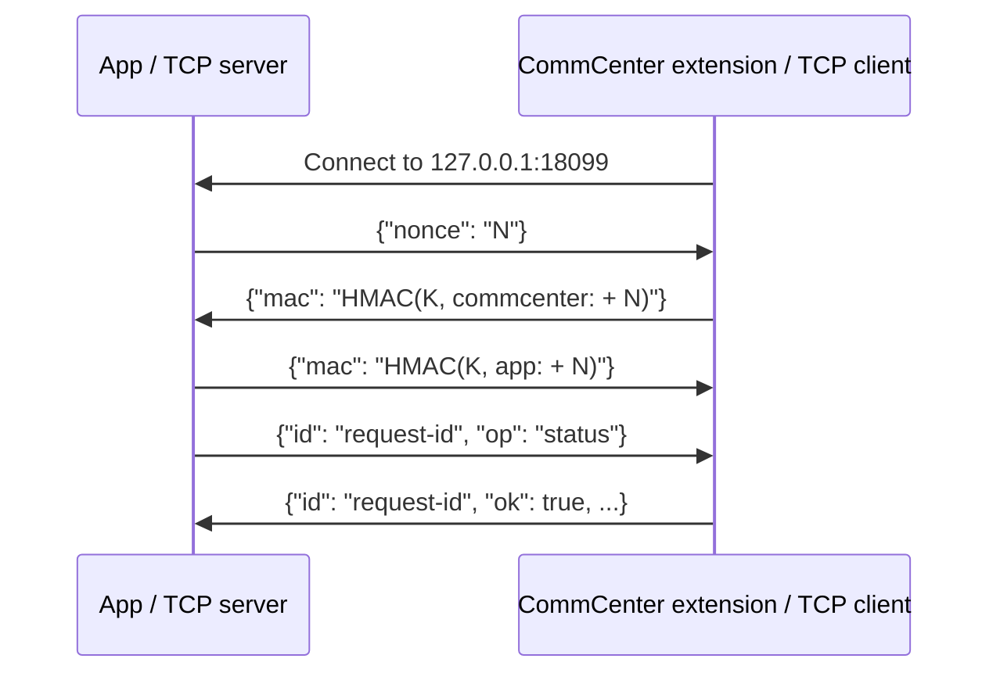

# App–CommCenter IPC protocol

**English** | [简体中文](IPC.zh-CN.md)

This document describes the implementation shipped in SIMHarbor 1.3.8. It is an internal protocol, without a negotiated protocol version. Sources: [app bridge](../viewer/Bridge.m), [extension](../tweak/Apdu.mm), [wire helpers](../shared/Wire.h), and [pairing generator](../scripts/generate_pairing_key.py).

## Transport and ownership

The UIKit app is the TCP server, bound to IPv4 loopback `127.0.0.1:18099`. The extension injected into CommCenter is the client. It reconnects after connection or authentication failures, waiting two seconds between attempts. Neither Frida nor an external server is required. ES9+ HTTPS requests to the profile server run separately in the app; they do not pass through this socket.

The app accepts one authenticated peer. A new authenticated connection replaces an old peer only when the old socket is detected as closed or broken; otherwise the new socket is closed. Requests on the accepted peer are serialized with a lock. There are no unsolicited events, multiplexed requests, heartbeat messages, or automatic request replay.

In 1.3.8, socket/bind/listen failures are logged and retried after one second. An `accept()` error other than `EINTR` is logged and triggers listener recreation after one second. `EINTR` retries acceptance. Previously startup failure ended the listener task permanently, and acceptance errors could spin on an unusable listener. Keeping the app in the foreground is still required; iOS background suspension is not bypassed.

## Framing

Each message is a UTF-8 JSON object followed by a single LF byte (`0x0a`). TCP packet boundaries have no meaning. The reader consumes bytes through LF, then parses a dictionary; EOF, socket errors, invalid JSON, non-object JSON, or a line exceeding the reader bound fail the read.

The current helper allows at most 262,144 serialized JSON bytes on write, then appends LF. The reader examines at most 262,144 bytes **including LF**, so interoperable payloads must be at most **262,143 bytes excluding LF**. This one-byte boundary mismatch is an implementation limitation. Normal APDU messages are much smaller. Hex fields contain pairs of hexadecimal characters; emitted hex is lowercase. The generic decoder accepts either case, while each operation adds its own constraints.

## Mutual authentication

Every build generates one random 32-byte value, encoded as a 64-character lowercase hex string and embedded in both binaries. HMAC uses the **UTF-8 bytes of that hex string**, not the decoded 32 bytes. The generated header is private build material and is removed after the build. Install the app and extension from the same deb; a separate rebuild normally generates another key.



`N` is 32 fresh random bytes encoded as 64 lowercase hex characters. HMAC is SHA-256; the message is the UTF-8 concatenation of the literal role prefix (`commcenter:` or `app:`) and `N`, with no newline or separator added beyond the prefix's colon. The digest is encoded as 64 lowercase hex characters. The diagram's `N`, `K`, and HMAC expressions are placeholders, not wire values. Handshake messages do not carry `id` or `op`. The app verifies the client's MAC before replying; the client verifies the app's MAC before reading commands.

This authenticates possession of the shared build key. It does not encrypt or authenticate subsequent JSON messages with a per-message MAC. It is not a security boundary against jailbreak root or a process that can extract the embedded key. There is no protocol negotiation or key rotation within an existing installation.

## Requests and replies

The app adds a fresh UUID string as `id` to each request. The extension echoes it in its reply. The app accepts a reply only when its `id` matches the outstanding request; missing or mismatched IDs close the peer connection. Success contains `ok: true`; an operation failure contains `ok: false` and an English `error` string. The app translates known errors for display and retains English logging.

| `op` | Request fields | Successful reply fields, in addition to `id` and `ok` |
| --- | --- | --- |
| `resolver` | None | `report`: resolver diagnostic object |
| `status` | None | `compatible`: ABI/hooks ready; `ready`: interface and selected slot could be resolved; `phase`: state integer; `resolver`: diagnostic object |
| `open` | `slot`: logical slot 1 or 2; `aid`: ISD-R AID hex | `channel`: allocated logical channel number |
| `transmit` | `hex`: command APDU, 4–261 bytes | `hex`: response APDU including trailing SW1/SW2 |
| `close` | None | No additional fields |

The only accepted AID is `a0000005591010ffffffff8900000100`. Slot numbers are logical identifiers; the resolver maps them to driver hardware slots. `status.ready` means object/slot availability, **not** that the modem reports an active SIM or that an eSIM profile is enabled. The initial selected logical slot is 2; `open` changes it. Resolver report fields are implementation diagnostics, not a stable external schema; see [Patchfinder](PATCHFINDER.md).

`resolver` and `status` remain available without an approved ABI. Other operations fail with `Unsupported firmware. No card command was sent.` until the firmware is compatible. An inactive SIM can use the driver's direct management-channel path. Listing, downloading, enabling, disabling, renaming, deleting, notifications and custom DER commands are LPA operations in the app, expressed through `open` / `transmit` / `close`; they have no separate IPC opcodes.

Example request and reply (illustrative channel and ID):

```json
{"id":"example-1","op":"open","slot":2,"aid":"a0000005591010ffffffff8900000100"}
{"id":"example-1","ok":true,"channel":1}
```

An operation failure keeps the same ID:

```json
{"id":"example-2","ok":false,"error":"The channel is not open."}
```

These are separate LF-terminated JSON messages, not one JSON document. The current implementation is a paired internal client/server and is not a hardened public API for arbitrary malformed field types.

## State, timeouts and recovery

The extension's `phase` is `0` idle, `1` opening, `2` open, `3` transmitting, or `4` closing. `open` requires idle. `transmit` requires an open retained channel. Successful `close` releases the session; closing an idle session succeeds. The extension attempts session cleanup after a socket disconnect; an in-progress driver operation may need to finish first. Reconnecting does not guarantee that card state has been reset.

| Setting | Current value |
| --- | --- |
| Handshake socket receive/send timeout, both peers | 5 seconds |
| App authenticated socket receive timeout | 35 seconds |
| App authenticated socket send timeout | 5 seconds, retained from handshake |
| Extension authenticated socket receive timeout | 120 seconds, including idle waiting |
| Extension authenticated socket send timeout | 5 seconds, retained from handshake |
| Extension driver completion wait | 25 seconds per wait |
| Extension reconnect delay | 2 seconds after failure/disconnect and any cleanup |
| App listener recreation delay | 1 second after failure |

These are socket/per-wait limits, not a total end-to-end deadline. The client uses blocking `connect()` without a separate nonblocking dial deadline. An idle extension connection can time out and reconnect. There is no exactly-once execution guarantee: if a write reached the card but its reply was lost, the app cannot determine the result from the transport failure alone. It does not automatically replay the request. Refresh/read state before deciding whether to repeat a state-changing operation.

## Diagnosing a disconnected service

`Card service is disconnected. Keep the app in the foreground and refresh later.` means no valid matching IPC reply was obtained. It does not by itself identify a missing card, an unsupported ABI, or a particular network error.

Check the English log for `IPC listener started`, `IPC peer authenticated`, listener startup/accept errors, and request/reply IDs. The 1.3.8 listener errors include the OS error text and number. Authentication rejection currently closes the socket without a detailed authentication log. A matching build and an injected, running extension are required even when the app remains in the foreground. APDU TX/RX logs are additional to IPC metadata; they contain card data and should be handled accordingly.

The listener recovery changes have passed local Objective-C syntax checks. Recovery across real device background/foreground transitions remains to be verified on the new package.
