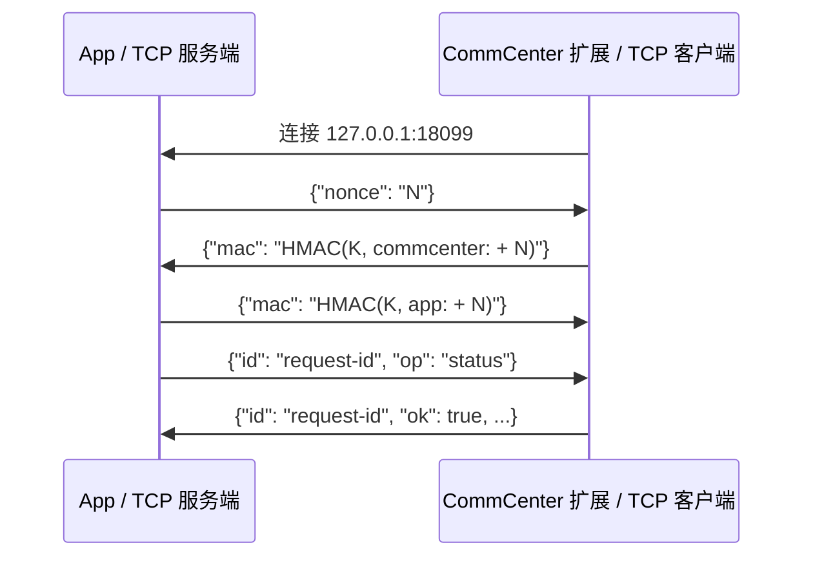

# App 与 CommCenter 通信协议

[English](IPC.md) | **简体中文**

本文描述 SIMHarbor 1.3.8 引入、至 1.3.20 保持报文边界及认证机制不变的通信协议。这是一套没有协议版本协商的内部协议。对应源码：[App 桥接层](../viewer/Bridge.mm)、[扩展](../tweak/Apdu.mm)、[报文辅助函数](../shared/Wire.h)、[配对值生成器](../scripts/generate_pairing_key.py)。

## 传输与连接方向

UIKit App 是 TCP 服务端，仅监听 IPv4 回环地址 `127.0.0.1:18099`；注入 CommCenter 的扩展是客户端。扩展在连接或认证失败后等待两秒重试。正常运行不需要 Frida 或外部服务器。App 到配置服务器的 ES9+ HTTPS 请求走独立网络连接，不经过这个 socket。

App 只保留一个已认证连接。新连接完成认证后，只有旧连接被检测为关闭或损坏时才接替旧连接，否则关闭新连接。请求通过锁串行处理，没有主动事件推送、并发多路请求、心跳或请求自动重放。

1.3.8 中，创建 socket、绑定或监听失败会记录日志，并在一秒后重试。`accept()` 遇到 `EINTR` 时继续接收，其他错误则记录日志并在一秒后重建监听。此前首次启动失败会永久结束监听任务，接收出错也可能持续循环使用已经失效的监听。App 仍需保持前台；该修复不会绕过 iOS 后台挂起机制。

## 报文边界

每条消息是一个 UTF-8 JSON 对象，末尾追加一个 LF 字节（`0x0a`）。TCP 分包不代表消息边界。接收方逐字节读取至 LF，再校验并解析为共享结构体；EOF、socket 错误、非法 JSON、非对象 JSON 或超过读取上限都会导致读取失败。

帧上限为 262,144 字节，包含末尾 LF，因此收发双方的 JSON 载荷均最多 262,143 字节。1.3.20 将发送上限与原接收上限对齐，消除原来相差一个字节的问题。正常 APDU 报文远小于此值。十六进制字段每两个字符表示一个字节，输出为小写，解码同时接受大小写。

## 双向认证

每次构建生成一个随机 32 字节值，编码为 64 个小写十六进制字符，同时嵌入 App 和扩展。HMAC 的密钥是这个**十六进制字符串的 UTF-8 字节**，不是解码后的 32 字节。生成的头文件属于私有构建材料，构建结束后删除。App 与扩展应从同一个 deb 安装；分别重新构建通常会得到不同的配对值。



`N` 是新生成的 32 字节随机数，编码为 64 个小写十六进制字符。HMAC 使用 SHA-256，消息是角色前缀（字面量 `commcenter:` 或 `app:`）与 `N` 拼接后的 UTF-8 字节，不额外添加换行或其他分隔符。摘要编码为 64 个小写十六进制字符。图中的 `N`、`K` 和 HMAC 表达式只是占位说明，不是实际报文值。握手消息不含 `id` 或 `op`。App 验证客户端 MAC 后才回复，客户端验证 App MAC 后才接收命令。

这套认证证明对端持有同一个构建配对值；它不会加密后续 JSON，也不会对后续消息逐条计算 MAC。它不能隔离越狱 root 或能够提取内嵌密钥的进程。当前没有协议协商，也没有安装后的密钥轮换机制。

## 请求与回复

App 为每个请求添加新的 UUID 字符串 `id`，扩展在回复中原样返回。App 只接受与当前请求 ID 一致的回复；ID 缺失或不一致会关闭连接。成功回复包含 `ok: true`；操作失败包含 `ok: false` 和英文 `error` 字符串。App 显示时翻译已知错误，日志保留英文。

| `op` | 请求字段 | 成功回复中除 `id`、`ok` 外的字段 |
| --- | --- | --- |
| `resolver` | 无 | `report`：解析器诊断对象 |
| `slots` | 无 | `slots`：已分配卡槽数组，各含 `logicalSlot`、`hardwareSlot`、`simReady`；`phase`：状态整数 |
| `status` | 可选 `slot`：逻辑卡槽 | `compatible`：ABI/Hook 已就绪；`ready`：接口和所选卡槽可解析；`phase`：状态整数；`resolver`：诊断对象；可解析时含 `logicalSlot`、`hardwareSlot`、`simReady` |
| `open` | `slot`：运行时发现的已分配正整数逻辑编号；`aid`：ISD-R AID 十六进制 | `channel`：分配的逻辑通道号；`logicalSlot`、`hardwareSlot`：实际映射 |
| `transmit` | `hex`：4～261 字节的命令 APDU | `hex`：包含末尾 SW1/SW2 的响应 APDU |
| `close` | 无 | 无额外字段 |

唯一允许的 AID 是 `a0000005591010ffffffff8900000100`。请求中的卡槽是逻辑编号，由解析器映射为驱动硬件卡槽。`status.ready` 表示对象和卡槽可用，**不代表**基带报告 SIM 已激活，也不代表某个 eSIM profile 已启用。不再固定选择卡槽 2；首次状态查询可以选择首个已分配卡槽，`open` 按请求确定目标。`slots` 不打开通道、不发送 APDU，跳过未分配逻辑编号，`simReady` 也不证明卡片支持 eUICC。App 的自动发现还会逐槽只读探测并核验 EID，详见[多卡槽文档](MULTI_SLOT.zh-CN.md)。解析器报告属于实现诊断，不是稳定的外部字段约定，详见 [Patchfinder 文档](PATCHFINDER.zh-CN.md)。

运行时发现失败时，`resolver` 和 `status` 仍可用。适配器布局、接口签名、代码计划及 Hook 安装通过前，其他操作返回 `Runtime compatibility checks did not pass. Open Firmware resolver for details. No card command was sent.`。UUID 不参与启用判断，打开通道前还要通过活对象和卡槽检查。SIM 未激活时可以通过驱动直接打开管理通道。列表、下载、启用、停用、重命名、删除、通知及自定义 DER 命令均由 App 内 LPA 实现，再转换为 `open` / `transmit` / `close`，没有独立 IPC 操作码。

请求与回复示例（ID、通道号仅作说明）：

```json
{"id":"example-1","op":"open","slot":2,"aid":"a0000005591010ffffffff8900000100"}
{"id":"example-1","ok":true,"channel":1,"logicalSlot":2,"hardwareSlot":2}
```

操作失败仍返回同一个 ID：

```json
{"id":"example-2","ok":false,"error":"The channel is not open."}
```

以上是多条独立的、以 LF 结束的 JSON 消息，不是一个 JSON 文档。成对客户端与服务端使用共用的 C++ 请求／回复结构体和 nlohmann/json 3.12.0。分派前检查必填项、字段类型、整数范围、操作码和载荷；拒绝重复键、非法 UTF-8 及超过 64 层的嵌套。帧或 schema 非法会关闭连接，未知字段则忽略。详见[共享 JSON 模型](JSON_MODELS.zh-CN.md)。

## 状态、超时与恢复

扩展的 `phase`：`0` 空闲、`1` 正在打开、`2` 已打开、`3` 正在传输、`4` 正在关闭。`open` 要求空闲；`transmit` 要求已经保留打开的通道。成功 `close` 会释放会话，空闲状态关闭也视为成功。socket 断开后，扩展会尝试清理会话；正在执行的驱动操作可能需要先完成。重新连接不保证卡片状态已经重置。

| 设置 | 当前值 |
| --- | --- |
| 双方握手阶段 socket 接收/发送超时 | 5 秒 |
| App 已认证 socket 接收超时 | 35 秒 |
| App 已认证 socket 发送超时 | 5 秒，沿用握手设置 |
| 扩展已认证 socket 接收超时，含空闲等待 | 120 秒 |
| 扩展已认证 socket 发送超时 | 5 秒，沿用握手设置 |
| 扩展等待驱动完成 | 每次等待 25 秒 |
| 扩展重连间隔 | 失败/断开并完成相应清理后等待 2 秒 |
| App 监听重建间隔 | 失败后等待 1 秒 |

这些是 socket 或单次等待的限制，不是整条操作的总截止时间。客户端使用阻塞式 `connect()`，没有另设非阻塞连接截止时间。扩展空闲连接可能超时并重新连接。协议不保证“恰好执行一次”：写入已经到达卡片但回复丢失时，App 无法仅凭传输失败判断执行结果，也不会自动重放请求。决定是否重复修改操作前，应先刷新或读取卡片实际状态。

## “未连接到卡片服务”的排查

`Card service is disconnected. Keep the app in the foreground and refresh later.` 表示未取得有效且 ID 匹配的 IPC 回复，单凭它无法判断是缺卡、不支持的 ABI，还是某种特定网络错误。

查看英文日志中的 `IPC listener started`、`IPC peer authenticated`、监听启动/接收错误和请求回复 ID。1.3.8 的监听错误包含系统错误文本及编号。认证拒绝目前只关闭 socket，不会记录具体认证原因。即使 App 一直在前台，仍要求扩展已注入、正在运行且双方来自匹配的构建。APDU TX/RX 日志在 IPC 元数据之外另行记录，其中可能包含卡片数据。

roothide 真机上的 1.3.10 已通过启动、卡片列表刷新和模拟 `accept()` 失败后的恢复测试，卡片列表保持一致。1.3.9 还通过了后台停留 163 秒后返回前台的测试。这些结果不代表已验证其他越狱方案或固件的运行兼容性。
