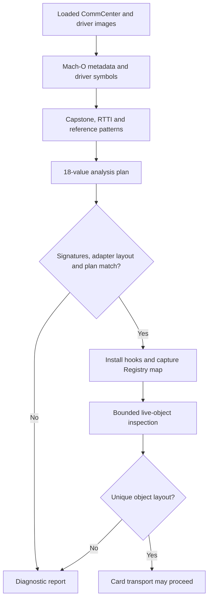

# How the Patchfinder works

**English** | [简体中文](PATCHFINDER.zh-CN.md)

SIMHarbor's Patchfinder discovers the private entry points and object fields used by its CommCenter transport. It combines loaded Mach-O metadata, module-scoped symbols, C++ RTTI, ARM64 instructions and read-only live-object inspection. Its output is a plan with values, evidence and errors; `Apdu.mm` separately installs hooks and uses the plan.

The implementation is split between [RuntimeResolver.mm](../tweak/RuntimeResolver.mm), which supplies the Darwin runtime and live-memory access, and [ResolverCore.cpp](../tweak/ResolverCore.cpp), which performs image analysis and bounded controller discovery. [ResolverCore.hpp](../tweak/ResolverCore.hpp) defines the `Image`, `Symbol` and `Plan` types.

## Discovery and runtime eligibility



Eligibility is determined from runtime evidence, without a device-model, iOS-build or UUID allowlist. Compiled adapter layout, complete driver signatures, function boundaries and a complete unique plan are checked before hooks. Card operations also require successful live-object and slot validation. UUIDs identify diagnostic samples only; a code-resolved report alone does not establish a usable card transport.

## 1. Describe the loaded images

`SHResolveFirmware` locates `CommCenter` and `libCommCenterMCommandDrivers.dylib` in dyld's loaded-image list. The image reader collects:

- Actual load bases, slide-adjusted segment/section ranges and executable sections.
- `LC_UUID`, identifying the exact binary build rather than a device or subscriber.
- Function entry addresses decoded from the ULEB128 deltas in `LC_FUNCTION_STARTS`.

Reads from these images are restricted to recorded readable ranges. Arbitrary live-object reads use `vm_read_overwrite`, with address, size and overflow checks. Pointer authentication bits are stripped for address comparisons; stripping is not authentication or proof that an object is valid. The transport constructs signed function pointers when it later calls resolved entry points.

Using loaded addresses makes the analysis follow ASLR. There is no table of old numerical addresses to use when a pattern fails.

## 2. Find driver anchors without a global symbol cache

`driverSymbols` dynamically binds CoreSymbolication, creates a symbolicator for the current task and obtains the symbol owner for the driver image. It enumerates only that owner, retaining `sendSimApdu` names whose addresses are executable function starts in the driver.

The core then filters demangled names for `subscriber::EURSimCommandDriver` and separates the named `sendSimApdu_start`, `sendSimApdu_command` and `sendSimApdu_close` methods from anonymous blocks belonging to the command method. Each anchor must have one distinct candidate.

These are name and boundary checks, not an automatic verification of complete C++ signatures. Availability of private cached symbols is a dependency; an export-only lookup is insufficient for the current driver. The production path does not initialize Gum's process-wide symbol cache or require GumJS/Frida server.

## 3. Decode instructions and identify command blocks

Capstone 5 comes from the pinned Frida Gum devkit. The code explicitly registers ARM64 and supplies libc allocation callbacks, then uses detailed decoding. `cs_disasm_iter` reuses one Capstone instruction/detail object rather than allocating a full-function array. Decoded records are retained only as needed by the analysis.

`loads` follows simple argument origins through register moves, records selected memory loads and discards caller-saved origins across `BL`. `refs` reconstructs selected `ADR`/`ADRP` plus `ADD` references. A small stub recognizer follows supported indirect branches when matching the exported readiness predicate.

This is bounded instruction-pattern analysis, not a complete control-flow graph, symbolic execution engine or compiler-independent dataflow analysis. Current functions need a following function boundary and must fit within a 64 KiB decoding limit.

The anonymous command blocks are distinguished using several observations together:

| Candidate | Evidence used by the current rule |
|---|---|
| Encoder | A vector-tail pair load from the second argument and an adjacent byte-capture pair in the block. |
| Response | A vector-span pair load from the second argument, a word-sized slot capture and the expected adjacent channel/instruction byte captures. |
| QMI result | A word load from the response argument together with a direct call to the already identified close method. |

The load displacements supply the channel, slot and error-field offsets. Relative capture-layout expectations remain part of the rules; arbitrary reordered layouts are not automatically supported.

## 4. Recover the controller, worker and completion

The RTTI scan recognizes the concrete `SubscriberSimController` type and APDU-related libc++ function closures. Candidate primary vtables require a zero offset-to-top and executable entries; the current entry walk is capped at 96 entries.

The resolver walks controller virtual methods and looks for a PC-relative reference to a worker function that references the named APDU task vtable. This identifies the sender and worker through their relationship, without a fixed virtual-method slot. The completion closure's invoke function is identified by its bool-reference load pattern.

Inside the worker:

- The call immediately before the exported `subscriber::isSimReady` predicate identifies the SimInfo state getter. Supported authenticated stubs are followed for the predicate match.
- A vector-bounds pair load, followed by a shared-pointer node load and a word-sized slot load, supplies the SimInfo vector and logical-slot offsets.

A schematic relationship is:

```text
controller virtual method -> worker reference -> named APDU task vtable
worker -> SimInfo state getter -> exported readiness predicate
worker -> vector bounds -> shared-pointer node -> logical-slot field
```

These are concrete relationships in the current implementation, not a claim that every compiler will emit equivalent patterns.

## 5. Inspect live objects without sending APDUs

Once runtime signature/layout checks and the code plan pass, hooks on the exported Registry getters capture the service-map pointer as CommCenter uses it. The getters only capture that pointer; bounded object discovery happens separately.

`findController` examines 32 root words and follows potential next-pointer chains, with caps of 512 steps per chain and 2,048 visited nodes overall. It inspects bounded node words and accepts only one distinct object matching the resolved controller vtable. This removes the previous fixed map, node-value and typeinfo-reference offsets, while retaining assumptions about the map's reachable pointer-chain shape.

`SHInferObjectLayout` derives two more fields:

1. **Driver member:** inspect pointer-aligned members within the first 512 bytes of the controller. The pointee must have the exact concrete driver RTTI name `N10subscriber19EURSimCommandDriverE`. A shared-pointer control block can contain the driver name in its own RTTI, so substring matching would create false candidates.
2. **Hardware slot:** read the discovered SimInfo vector using the compiled `shared_ptr` stride. Current rules accept 1–16 nodes. Scan aligned integer fields within their first 128 bytes, excluding the logical-slot field; accept one field whose values are distinct hardware-slot candidates in the range 1–3 across the nodes.

These field correlations are heuristics, not proof of slot semantics on a new device. During initialization there may be several candidates; the transport rejects the layout until a later inspection resolves it uniquely. Logical and hardware slots remain separate values.

## What is resolved?

| Source | Plan values |
|---|---|
| Driver symbols and block analysis | `driverStart`, `driverCommand`, `driverClose`, `encoder`, `response`, `qmi` |
| Driver load displacements | `encoderChannel`, `responseSlot`, `responseChannel`, `qmiError` |
| RTTI, references and worker instructions | `controllerVtable`, `sender`, `worker`, `completion`, `simState`, `simVector`, `logicalSlot` |
| Export lookup | `isReady` |
| Live-object inspection | `driverMember`, `hardwareSlot` |

The first four rows form the 18-value code/image plan; the last row adds two live-object fields. Registry getters are also found through exports, outside this count.

## Failure handling and diagnostics

The core's `only` helper deduplicates candidates and requires exactly one distinct value. Missing or ambiguous anchors, incompatible captures or failed decoding leave the plan incomplete with explicit errors. There is no guessed numerical fallback. Expected matching failures return status/errors rather than relying on C++ exception unwinding.

The firmware report exposes UUIDs, `compiledAbiCompatible`, `signaturesValidated`, `abiCompatible`, `hookStage`, `codeResolved`, `objectLayoutResolved`, value sources, candidate counts and errors. `analysisMilliseconds` measures the static resolution phase; `maxMeasuredFootprintBytes` is the largest of a few phase samples, not a continuously measured memory peak.

Module-scoped symbolication and iterative decoding reduce temporary memory use inside CommCenter. Earlier process-wide enumeration exceeded the daemon's memory budget, so it is deliberately absent from the production path.

## Porting and validation

Since 1.3.14, the driver open/command/close symbols must also match their complete demangled parameter signatures, including slot type, vector references, callback/block arguments and libc++ namespace. Whitespace differences are normalized. Matching a method name alone is insufficient. Registry getters are validated in their actual owning loaded image, using executable-section membership and a function-start or exact exported-symbol boundary; `registryImage` identifies that owner. `hookStage` is 0 before installation, 1 during installation, 2 after required original-function pointers are obtained, or 3 on failure. Live-object diagnostics explain what is still missing.

[shared/Firmware.h](../shared/Firmware.h) checks only the compiled ARM64 adapter layout, not firmware identities. Complete demangled driver signatures are compared with the interface shapes the adapter uses; Capstone and live-object checks supply further evidence. There is no UUID enrollment step. This is compatibility inference, not a formal proof of private calling conventions, callback lifetimes or slot meanings.

Changed symbols, stripped RTTI, different compiler output, oversized functions, a different service-map shape, ambiguous SimInfo/slot fields may require new rules. Preserve rejection on ambiguity, add image-replay/negative cases and revalidate existing builds before claiming validation on a target.

[tests/test_resolver.cpp](../tests/test_resolver.cpp) replays authorized image fixtures and covers known results, ASLR relocation, missing/ambiguous/interior symbols, unreadable images and cyclic/ambiguous object chains. Fixtures are private and excluded from Git and CI. This replay does not exercise Darwin symbolication, all live-layout heuristics, hook execution or complete profile management; those need separate device checks. See the [porting guide](ARCHITECTURE_PORTING.md) and [validation scope](VALIDATION.md).

This article remains repository documentation. The app bundles only its bilingual user guide; its firmware report remains a separate diagnostic tool.
