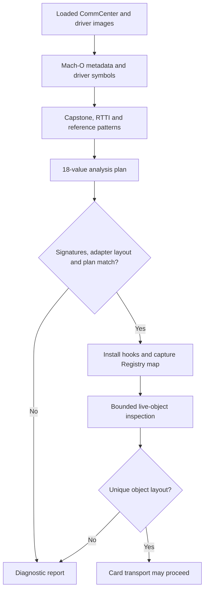

# How the Patchfinder works

**English** | [简体中文](PATCHFINDER.zh-CN.md)

SIMHarbor's Patchfinder discovers the private entry points and object fields used by its CommCenter transport. It combines loaded Mach-O metadata, module-scoped symbols, C++ RTTI, ARM64 instructions and read-only live-object inspection. Its output is a plan with values, evidence and errors; `Apdu.mm` separately installs hooks and uses the plan.

The implementation is split between [RuntimeResolver.mm](../tweak/RuntimeResolver.mm), which supplies the Darwin runtime and live-memory access, and [ResolverCore.cpp](../tweak/ResolverCore.cpp), which performs image analysis and bounded controller discovery. [ResolverCore.hpp](../tweak/ResolverCore.hpp) defines the `Image`, `Symbol` and `Plan` types.

The transport call flow, callback ownership and state transitions are explained in [CommCenter transport](COMMCENTER_TRANSPORT.md).

## Discovery and runtime eligibility



Eligibility is determined from runtime evidence, without a device-model, iOS-build or UUID allowlist. Compiled adapter layout, complete driver signatures, function boundaries and a complete unique plan are checked before hooks. Card operations also require successful live-object and slot validation. UUIDs identify diagnostic samples only; a code-resolved report alone does not establish a usable card transport.

## 1. Describe the loaded images

`SHResolveFirmware` locates `CommCenter` and `libCommCenterMCommandDrivers.dylib` in dyld's loaded-image list. The image reader collects:

- Actual load bases, slide-adjusted segment/section ranges and executable sections.
- `LC_UUID`, identifying the exact binary build rather than a device or subscriber.
- Function entry addresses decoded from the ULEB128 deltas in `LC_FUNCTION_STARTS`.

Reads from these images are restricted to recorded readable ranges. Arbitrary live-object reads use `vm_read_overwrite`, with address, size and overflow checks. Pointer authentication bits are stripped for address comparisons; stripping is not authentication or proof that an object is valid. The transport constructs signed function pointers when it later calls resolved entry points.

Using loaded addresses makes the analysis follow ASLR. There is no table of old numerical addresses to use when a pattern fails.

## 2. Find driver anchors without a global symbol cache

`driverSymbols` dynamically binds CoreSymbolication, creates a symbolicator for the current task and obtains the symbol owner for the driver image. It enumerates only that owner, retaining `sendSimApdu` names whose addresses are executable function starts in the driver.

The core then filters demangled names for `subscriber::EURSimCommandDriver` and separates the named `sendSimApdu_start`, `sendSimApdu_command` and `sendSimApdu_close` methods from anonymous blocks belonging to the command method. Each anchor must have one distinct candidate.

The three named entry points also undergo complete demangled parameter-signature comparison, including the slot type, vector references and callback/block parameters, after whitespace normalization. These checks do not prove every aspect of the private ABI. Availability of private cached symbols is a dependency; an export-only lookup is insufficient for the current driver. The production path does not initialize Gum's process-wide symbol cache or require GumJS/Frida server.

## 3. Decode instructions and identify command blocks

Capstone 5 comes from the pinned Frida Gum devkit. The code explicitly registers ARM64 and supplies libc allocation callbacks, then uses detailed decoding. `cs_disasm_iter` reuses one Capstone instruction/detail object rather than allocating a full-function array. Decoded records are retained only as needed by the analysis.

`loads` follows simple argument origins through register moves, records selected memory loads and discards caller-saved origins across `BL`. `refs` reconstructs selected `ADR`/`ADRP` plus `ADD` references. A small stub recognizer follows supported indirect branches when matching the exported readiness predicate.

This is bounded instruction-pattern analysis, not a complete control-flow graph, symbolic execution engine or compiler-independent dataflow analysis. Current functions need a following function boundary and must fit within a 64 KiB decoding limit.

The anonymous command blocks are distinguished using several observations together:

| Candidate | Evidence used by the current rule |
|---|---|
| Encoder | A vector-tail pair load from the second argument and an adjacent byte-capture pair in the block. |
| Response | A vector-span pair load from the second argument, a word-sized slot capture and the expected adjacent channel/instruction byte captures. |
| QMI result | A word load from the response argument together with a direct call to the already identified close method. |

The load displacements supply the channel, slot and error-field offsets. Relative capture-layout expectations remain part of the rules; arbitrary reordered layouts are not automatically supported.

## 4. Recover the controller, worker and completion

The RTTI scan recognizes the concrete `SubscriberSimController` type and APDU-related libc++ function closures. Candidate primary vtables require a zero offset-to-top and executable entries; the current entry walk is capped at 96 entries.

The resolver walks controller virtual methods and looks for a PC-relative reference to a worker function that references the named APDU task vtable. This identifies the sender and worker through their relationship, without a fixed virtual-method slot. The completion closure's invoke function is identified by its bool-reference load pattern.

Inside the worker:

- The call immediately before the exported `subscriber::isSimReady` predicate identifies the SimInfo state getter. Supported authenticated stubs are followed for the predicate match.
- A vector-bounds pair load, followed by a shared-pointer node load and a word-sized slot load, supplies the SimInfo vector and logical-slot offsets.

A schematic relationship is:

```text
controller virtual method -> worker reference -> named APDU task vtable
worker -> SimInfo state getter -> exported readiness predicate
worker -> vector bounds -> shared-pointer node -> logical-slot field
```

These are concrete relationships in the current implementation, not a claim that every compiler will emit equivalent patterns.

## 5. Inspect live objects without sending APDUs

Once runtime signature/layout checks and the code plan pass, hooks on the exported Registry getters capture the service-map pointer as CommCenter uses it. The getters only capture that pointer; bounded object discovery happens separately.

`findController` examines 32 root words and follows potential next-pointer chains, with caps of 512 steps per chain and 2,048 visited nodes overall. It inspects bounded node words and accepts only one distinct object matching the resolved controller vtable. This removes the previous fixed map, node-value and typeinfo-reference offsets, while retaining assumptions about the map's reachable pointer-chain shape.

Live-object reads use `MemoryReader`, `ControllerView`, `SharedPointerVectorView` and `SimInfoView` in [RuntimeObjects.hpp](../tweak/RuntimeObjects.hpp). `SHMakeControllerView` supplies discovered field offsets and the compiled shared-pointer stride. The views copy trivially-copyable snapshots without casting foreign memory to owning STL objects or modifying reference counts. Failed reads and invalid bounds return `nullopt`. They do not retain the target objects, make concurrent mutations atomic, or guarantee that a later private getter call remains safe.

`SHInferObjectLayout` derives two more fields:

1. **Driver member:** inspect pointer-aligned members within the first 512 bytes of the controller. The pointee must have the exact concrete driver RTTI name `N10subscriber19EURSimCommandDriverE`. A shared-pointer control block can contain the driver name in its own RTTI, so substring matching would create false candidates.
2. **Hardware slot:** read the discovered SimInfo vector using the compiled `shared_ptr` stride. Current rules accept 1–16 nodes. Scan aligned integer fields within their first 128 bytes, excluding the logical-slot field; accept one field whose values are distinct hardware-slot candidates in the range 1–3 across the nodes.

These field correlations are heuristics, not proof of slot semantics on a new device. During initialization there may be several candidates; the transport rejects the layout until a later inspection resolves it uniquely. Logical and hardware slots remain separate values.

## What is resolved?

| Source | Plan values |
|---|---|
| Driver symbols and block analysis | `driverStart`, `driverCommand`, `driverClose`, `encoder`, `response`, `qmi` |
| Driver load displacements | `encoderChannel`, `responseSlot`, `responseChannel`, `qmiError` |
| RTTI, references and worker instructions | `controllerVtable`, `sender`, `worker`, `completion`, `simState`, `simVector`, `logicalSlot` |
| Export lookup | `isReady` |
| Live-object inspection | `driverMember`, `hardwareSlot` |

The first four rows form the 18-value code/image plan; the last row adds two live-object fields. Registry getters are also found through exports, outside this count.

## Each result: purpose, consumer and discovery

The word “offset” covers different kinds of values here. A **function address** is called or hooked; a **vtable address** identifies an object or anchors code discovery; a **member offset** is added to a particular object or callback argument before reading a field. Do not add a member offset to an image base. The report's `imageOffset` is the address relative to its owning image for comparison across ASLR slides; the transport calls the resolved address itself. `driverMember` and `hardwareSlot` are byte offsets even though the report prints them as integers.

Numerical observations for the tested image are in the [example discovery results](manual/en/porting.md#example-discovery-results). They are reference observations, not inputs to the algorithms below. The consumers are in [Apdu.mm](../tweak/Apdu.mm); static discovery is in `resolve` in [ResolverCore.cpp](../tweak/ResolverCore.cpp), and live-field discovery is in `SHInferObjectLayout` in [RuntimeResolver.mm](../tweak/RuntimeResolver.mm).

### A. Driver entry points and callback addresses — 6 results

| Result | Why it is needed / actual consumer | How it is found and checked |
|---|---|---|
| `driverStart` | Open ISD-R directly when the modem does not report the SIM ready, allowing management of an inactive card/profile. The `open` handler calls it with the live driver, mapped hardware slot, AID and callbacks; this path receives the allocated channel in its opening callback. | Enumerate driver-owned symbols, select the non-block `EURSimCommandDriver::sendSimApdu_start` entry, verify the complete parameter signature, executable-image membership and function-start boundary, and require one distinct address. |
| `driverCommand` | Hooked by `commandHook` to capture the driver, channel and response-vector reference during the ordinary opening path. Later `transmit` calls `commandOrig` to trigger another exchange on the retained channel; the actual APDU is substituted by the encoder hook. | Select the non-block `sendSimApdu_command` symbol in the driver with its complete parameter signature, executable function-start checks and unique address. Its nested blocks form the callback search space. |
| `driverClose` | `closeHook` intercepts the matching automatic close after opening/transmission, retains its callback and leaves the management channel open. Explicit `closeSession` invokes `closeOrig` to close it and release retained state. | Select the non-block `sendSimApdu_close` symbol with the expected full parameter signature and unique executable function start. Its address is also an anchor for recognizing the QMI callback's direct close call. |
| `encoder` | `encodeHook` first calls the original encoder, then replaces the generated vector with the pending app APDU during an active transmit on the selected channel. This is the point where app bytes enter the modem exchange; passing raw APDU bytes as the high-level sender's AID would not provide this behavior. | Among blocks nested in `sendSimApdu_command`, select the unique block with a vector-tail `LDP` from its second argument at displacement 8. Its byte captures must subsequently satisfy the adjacent-pair rule used for `encoderChannel`. |
| `response` | `responseHook` copies the raw response vector for the active hardware slot and channel, preserving the response APDU including SW1/SW2 for the app, then calls the original callback. | Select the unique command block combining a vector-span `LDP` from its second argument at displacement 0 with a positive word-sized slot capture. Its slot/channel/instruction captures must satisfy the relative-layout checks described below. |
| `qmi` | `qmiHook` records the modem transport result while a transmit is active, then calls the original callback. A nonzero result causes the transport to report failure even when some response bytes exist. | Select the unique command block that loads a word from the response argument within its first 32 bytes and directly calls the already resolved `driverClose`. The field extraction must also yield a unique positive word displacement. |

### B. Controller and session addresses — 6 results

| Result | Why it is needed / actual consumer | How it is found and checked |
|---|---|---|
| `controllerVtable` | A data address, not an offset of a virtual method. `findController` compares candidate object vptrs with it to identify the unique live `SubscriberSimController`; its entries also provide the methods searched for `sender`. | Find RTTI with the exact type name `23SubscriberSimController`, follow its references to a primary vtable with zero offset-to-top, require executable entries and one distinct vtable. The stored address is the vtable address point used by the object's vptr. |
| `sender` | The ordinary `open` path calls this controller method with the **logical** slot and shared AID/output vectors. It starts the high-level exchange from which the driver/channel/vector can be captured and retained. | Walk controller-vtable methods. Require a supported PC-relative reference to an executable worker function start that in turn references the identified APDU task vtable. Deduplicate and require one sender and one worker. No virtual-slot index is fixed. |
| `worker` | An analysis anchor: the transport does **not** call or hook it directly. Its body links the sender to the APDU task and supplies the state getter and SimInfo field discoveries. | Resolve the unique controller-method → worker → APDU-task-vtable reference chain. The worker must be a function start inside CommCenter. |
| `completion` | `completionHook` observes completion of the high-level task after invoking its original function. It releases a pending close wait or reports the failed opening path through the transport phase/semaphore state. The direct-opening path additionally has its own retained callback. | Identify the APDU bool-completion closure through RTTI, inspect its vtable entries, and select the unique entry containing a byte load of the bool referenced by the second argument, modeled as `LDRB w1, [x1]`. The entry is inferred from instructions rather than a fixed invoke slot. |
| `simState` | `slotInfo` calls this getter on the selected `SimInfo` object; its result is passed to `isReady` to choose the ordinary sender or direct driver opening path. | In the worker, find a `BL` whose target, after supported stub resolution, is the exported readiness predicate. The preceding direct call target must be executable and unique; that target is the state getter. |
| `isReady` | Interpret the returned modem/SIM state without hardcoding a state-enum number. This predicate says whether the SIM is ready for the normal path; it is not a profile-list enabled-state flag. | Resolve `_ZN10subscriber10isSimReadyENS_8SimStateE` through `dlsym`. Use it as the worker-call anchor, following supported stubs when comparing call targets. A missing export leaves the plan incomplete. |

### C. Fields recovered from instructions — 6 byte offsets

| Result / base object | Why it is needed / actual consumer | How it is found and checked |
|---|---|---|
| `encoderChannel` / encoder block `b` | `encodeHook` reads `b + encoderChannel` as a byte and substitutes the pending APDU only for the active channel. | From tracked loads in the identified encoder, collect positive byte displacements from the block argument. Require exactly two distinct consecutive offsets; use the smaller as the channel field. The adjacent instruction-byte field is a validation companion, not a separately published result. |
| `responseSlot` / response block `b` | `responseHook` reads an integer at `b + responseSlot` and compares it with the active **hardware** slot before copying response bytes. | Collect word-sized positive loads from the response block argument and require a unique displacement. Validate it together with the two byte captures. |
| `responseChannel` / response block `b` | The response hook also reads the channel byte at this offset, so an unrelated channel's response is not copied merely because the slot matches. | The response block must have exactly two distinct byte-capture displacements. The first must equal `responseSlot + 4`, and the second must immediately follow it; use the first as the channel field. Arbitrary capture-field reordering is not supported by this rule. |
| `qmiError` / QMI result argument `r` | `qmiHook` reads an integer at `r + qmiError` and makes it available to `transmit`'s transport-result check. The offset is relative to the **second callback argument**, not to the block object. | After recognizing `qmi`, inspect its tracked loads from argument 1 and require one positive word-load displacement. The callback classifier additionally requires a result-word load in the first 32 bytes and a close call. |
| `simVector` / controller `iface` | `slotInfo` and `SHInferObjectLayout` read the vector's begin/end pointers at `iface + simVector`, then walk shared-pointer entries to reach `SimInfo` objects. This is a container-member location, not the address of the first SIM object. | In the worker, find a positive non-stack `LDP` displacement, a nearby zero-displacement pointer load through its first result, and a following word load from that pointee. Require a unique vector/slot displacement pair. Runtime checks validate bounds, compiled shared-pointer stride and a 1–16 entry count. |
| `logicalSlot` / a `SimInfo` object | `slotInfo` reads this integer to select the node matching the app's logical-slot request. Only after this match does it read that node's hardware-slot field for the driver. | Take the word-load displacement at the end of the vector-entry → pointee → slot-load chain above and require one distinct value. The pattern constrains the nearby load sequence; it does not infer a hardware-slot number from the request. |

### D. Fields recovered from live objects — 2 byte offsets

| Result / base object | Why it is needed / actual consumer | How it is found and checked |
|---|---|---|
| `driverMember` / controller `iface` | The inactive-SIM/direct-opening path reads the driver pointer from `iface + driverMember` before calling `driverStart`. On the ordinary sender path the driver is captured by `commandHook` instead. | Scan pointer-aligned members after the controller vptr within its first 512 bytes. Follow each readable pointee's vptr/typeinfo/name and accept exactly one with concrete RTTI `N10subscriber19EURSimCommandDriverE`; exclude shared-pointer control blocks by exact-name matching. Store the member displacement, not the current driver pointer. |
| `hardwareSlot` / a `SimInfo` object | Translate the selected logical SIM node to the driver's hardware slot. Driver start/command/close calls and response-slot matching use this hardware value, which need not equal the app's logical slot. | Read nodes from the discovered SimInfo vector. Scan aligned integer fields in their first 128 bytes, excluding `logicalSlot`; require a unique candidate field whose values lie in 1–3 and are distinct across nodes. This is a correlation heuristic; ambiguity or unreadable data blocks use of the layout. |

The selection path can be summarized as follows; it describes the existing reads rather than a standalone callable API:

```text
registryMap -> findController(controllerVtable) -> iface
iface + simVector -> shared-pointer entries -> SimInfo
SimInfo + logicalSlot -> select the requested logical node
SimInfo + hardwareSlot -> driver hardware-slot value
isReady(simState(SimInfo)) -> ordinary sender or direct driverStart path
iface + driverMember -> driver pointer for the direct path
```

`qmiError`, APDU SW1/SW2 and the decoded ES10b installation `errorReason` are different error layers. Finding the modem result field does not locate a “profile already installed” flag; installation-result decoding happens in the LPA/libeuicc layer.

### E. Export and temporary anchors outside the 20 results

| Anchor | Purpose | Discovery / treatment |
|---|---|---|
| `getter` | Hook the exported Registry service-map getter and capture the pointer returned during CommCenter's normal use. This supplies the root for live-controller discovery without a fixed Registry member offset. | Try `_ZNK8Registry13getServiceMapEv`; validate executable membership in the actual owning loaded image and a function-start or exact exported-symbol boundary. If unavailable/invalid, use the validated mutable getter. The observed owner is reported as `registryImage`; it need not be the CommCenter executable. |
| `mutableGetter` | Capture the same map through the non-const overload when it is independently available and distinct. One validated getter is sufficient. | Resolve `_ZN8Registry13getServiceMapEv`, validate it in its own image, and hook it separately only when it differs from the chosen `getter`. |
| APDU task vtable | Connect an otherwise unnamed worker to the operation of interest. It is an analysis anchor, not a callable transport entry or fixed object offset. | Restrict RTTI candidates to APDU closures containing `sendSimSingleApduCommand_sync`; select the non-nested `__funcIZN…` form with `Fvv`, and require one candidate. Match worker references to this vtable. |
| Bool-completion vtable | Limit the search for `completion` to the relevant callback's implementations. | Within the same APDU RTTI family, select the nested `__funcIZZN…` form and require uniqueness, then apply the bool-reference load rule to its entries. |

`registryMap`, `iface`, `driver`, the channel number, `responseVector` and the retained callback are live handles captured or read at runtime, not additional portable numerical offsets. Old map/node-value/typeinfo-reference offsets and fixed controller/invoke vtable indices are no longer configuration inputs; bounded traversal, RTTI and code references replace them.

## Failure handling and diagnostics

The core's `only` helper deduplicates candidates and requires exactly one distinct value. Missing or ambiguous anchors, incompatible captures or failed decoding leave the plan incomplete with explicit errors. There is no guessed numerical fallback. Expected matching failures return status/errors rather than relying on C++ exception unwinding.

The firmware report exposes UUIDs, `compiledAbiCompatible`, `signaturesValidated`, `abiCompatible`, `hookStage`, `codeResolved`, `objectLayoutResolved`, value sources, candidate counts and errors. `analysisMilliseconds` measures the static resolution phase; `maxMeasuredFootprintBytes` is the largest of a few phase samples, not a continuously measured memory peak.

Module-scoped symbolication and iterative decoding reduce temporary memory use inside CommCenter. Earlier process-wide enumeration exceeded the daemon's memory budget, so it is deliberately absent from the production path.

## Porting and validation

Since 1.3.14, the driver open/command/close symbols must also match their complete demangled parameter signatures, including slot type, vector references, callback/block arguments and libc++ namespace. Whitespace differences are normalized. Matching a method name alone is insufficient. Registry getters are validated in their actual owning loaded image, using executable-section membership and a function-start or exact exported-symbol boundary; `registryImage` identifies that owner. `hookStage` is 0 before installation, 1 during installation, 2 after required original-function pointers are obtained, or 3 on failure. Live-object diagnostics explain what is still missing.

[shared/Firmware.h](../shared/Firmware.h) checks only the compiled ARM64 adapter layout, not firmware identities. Complete demangled driver signatures are compared with the interface shapes the adapter uses; Capstone and live-object checks supply further evidence. There is no UUID enrollment step. This is compatibility inference, not a formal proof of private calling conventions, callback lifetimes or slot meanings.

Changed symbols, stripped RTTI, different compiler output, oversized functions, a different service-map shape, ambiguous SimInfo/slot fields may require new rules. Preserve rejection on ambiguity, add image-replay/negative cases and revalidate existing builds before claiming validation on a target.

[tests/test_resolver.cpp](../tests/test_resolver.cpp) replays authorized image fixtures and covers known results, ASLR relocation, missing/ambiguous/interior symbols, unreadable images and cyclic/ambiguous object chains. Fixtures are private and excluded from Git and CI. This replay does not exercise Darwin symbolication, all live-layout heuristics, hook execution or complete profile management; those need separate device checks. See the [porting guide](ARCHITECTURE_PORTING.md) and [validation scope](VALIDATION.md).

This article remains repository documentation. The app bundles only its bilingual user guide; its firmware report remains a separate diagnostic tool.

Slot management skips unassigned SimInfo nodes (logical ID ≤ 0), while retaining assigned inactive slots. Such placeholder nodes remain relevant to layout discovery; do not hardcode a hardware ID exclusion. Logical IDs are discovered rather than restricted to 1/2. See [multiple slots](MULTI_SLOT.md) for routing, EID protection and test scope.

### Known inline-container gap

Offline file-model replay of the iPhone 12 mini iOS 16.5.1 (20F75) image validates driver signatures and reaches the final worker-layout stage, where the current shared-pointer pattern finds no candidate. The observed loop loads bounds at controller `+0xf8`, reads a word directly from the cursor at `+0x4`, and advances the cursor by `0x138`; the matched cursor is passed to the state getter. This is inline SimInfo storage. The established 17.2.1 sample instead dereferences shared-pointer entries before reading logical ID `+0x24`.

These are observations for those samples, not version-based constants. Supporting the inline case requires discovering both entry representation and stride, then adapting the borrowed container view and live-field validation. Updating only `simVector` would retain the wrong pointer traversal. The current adapter has not yet implemented this path. The [host replay tools](../research/firmware/README.md#file-model-resolver-replay) model fixups and reproduce the discovery gap without executing iOS code; they do not validate runtime symbolication, hooks, object lifetime or card communication.
