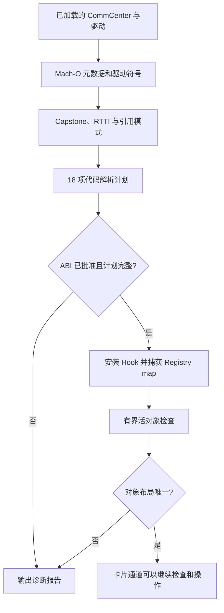

# Patchfinder 是怎么工作的

[English](PATCHFINDER.md) | **简体中文**

SIMHarbor 的 Patchfinder 用于定位 CommCenter 通道依赖的私有入口和对象字段。它结合已加载 Mach-O 的元数据、模块级符号、C++ RTTI、ARM64 指令和只读活对象检查，输出带有数值、依据和错误的解析计划；随后由 `Apdu.mm` 单独安装 Hook 和使用这些结果。

实现分为两部分：[RuntimeResolver.mm](../tweak/RuntimeResolver.mm) 负责 Darwin 运行时与活内存访问，[ResolverCore.cpp](../tweak/ResolverCore.cpp) 负责镜像分析和有界控制器搜索。[ResolverCore.hpp](../tweak/ResolverCore.hpp) 定义 `Image`、`Symbol` 和 `Plan` 数据结构。

## 定位与批准的关系



找到位置和允许调用接口是两项独立判断。未知镜像 UUID 对可以进行诊断分析，但不会安装通道 Hook。ABI 已批准且代码计划完整后才安装 Hook；卡片操作还要求活对象和卡槽校验通过。因此，报告中“代码已解析”本身不能证明卡片通道已经可用。

## 1. 描述已加载镜像

`SHResolveFirmware` 从 dyld 镜像列表找到 `CommCenter` 和 `libCommCenterMCommandDrivers.dylib`，读取：

- 实际加载基址、应用 slide 后的段/节范围，以及可执行节。
- `LC_UUID`，用于标识具体二进制构建，不是设备或用户标识。
- `LC_FUNCTION_STARTS`，将 ULEB128 编码的地址增量还原成函数入口列表。

镜像读取限定在记录的可读范围内；任意活对象读取则使用 `vm_read_overwrite`，并检查地址、长度和溢出。指针比较前去除 PAC 位；去掉 PAC 并不等于验证了指针或对象。之后真正调用入口时，通道代码会构造相应的已签名函数指针。

分析使用当前加载地址，因此可以跟随 ASLR。匹配失败时不会转用历史数值地址表。

## 2. 用模块级符号定位驱动锚点

`driverSymbols` 动态绑定 CoreSymbolication，为当前进程创建 symbolicator，然后取得驱动镜像对应的 symbol owner。它只枚举该模块，保留名称包含 `sendSimApdu`、地址位于驱动可执行范围且属于函数起点的符号。

核心进一步筛选 `subscriber::EURSimCommandDriver` 的反修饰名称，将 `sendSimApdu_start`、`sendSimApdu_command`、`sendSimApdu_close` 三个普通方法，与命令方法内的匿名 block 区分开来。每个锚点都必须只有一个不同的候选地址。

这里自动检查的是名称和边界，不是完整 C++ 函数签名。当前驱动依赖私有符号缓存，仅查导出表不能满足要求。生产路径不初始化 Gum 的全进程符号缓存，也不需要 GumJS 或 Frida server。

## 3. 解码指令并识别命令回调

ARM64 解码使用固定版本 Frida Gum devkit 中的 Capstone 5。初始化时显式注册 ARM64、配置 libc 内存函数并开启详细解码。通过 `cs_disasm_iter` 复用一个 Capstone 指令/详情对象，避免为整个函数分配 Capstone 详情数组；分析只按需保留解码后的记录。

`loads` 通过部分寄存器移动跟踪参数来源，记录选定的内存加载，并在遇到 `BL` 后清除调用者保存寄存器的来源。`refs` 还原部分 `ADR`/`ADRP` 加 `ADD` 的地址引用；小型 stub 识别器用于跟随支持的间接跳转，匹配导出的就绪判断函数。

这是有界指令模式分析，不是完整的控制流图、符号执行或与编译器无关的数据流分析。当前函数解码要求存在下一个函数边界，且长度不超过 64 KiB。

匿名命令 block 由多项特征共同区分：

| 候选 | 当前规则使用的依据 |
|---|---|
| 编码回调 | 从第二个参数读取 vector 尾部指针对，并从 block 加载相邻字节捕获字段。 |
| 响应回调 | 从第二个参数读取 vector 范围指针对，存在字长槽位字段，以及符合相对布局的通道/指令字节字段。 |
| QMI 结果回调 | 从响应参数读取字长结果字段，并直接调用已定位的关闭方法。 |

加载指令中的 displacement 给出通道、槽位和错误字段偏移。规则仍约束捕获字段之间的相对布局，并不会自动支持任意字段重排。

## 4. 还原控制器、worker 和完成回调

RTTI 扫描识别具体的 `SubscriberSimController` 类型，以及 APDU 相关 libc++ 函数闭包。候选主虚表要求 offset-to-top 为零，且入口指向可执行区域；当前最多遍历 96 个虚表入口。

解析器遍历控制器虚方法，寻找对某个 worker 函数的 PC 相对引用；该 worker 还必须引用指定 APDU 任务的虚表。借助这一关系定位 sender 和 worker，不固定某个虚方法槽位。完成闭包的 invoke 函数则通过读取 bool 引用的指令模式识别。

worker 内还有两项推导：

- 导出的 `subscriber::isSimReady` 判断之前的那次调用，用于识别 SimInfo 状态读取函数。匹配就绪函数时会跟随支持的认证跳转 stub。
- vector 边界指针对加载、shared-pointer 节点加载以及字长槽位加载，给出 SimInfo vector 和逻辑槽字段偏移。

关系示意：

```text
控制器虚方法 -> worker 引用 -> 指定 APDU 任务虚表
worker -> SimInfo 状态函数 -> 导出的就绪判断
worker -> vector 边界 -> shared-pointer 节点 -> 逻辑槽字段
```

这些关系描述当前实现的规则，不代表所有编译器都会生成相同形式。

## 5. 不发送 APDU 的活对象检查

ABI 和代码计划通过后，扩展 Hook 导出的 Registry getter，在 CommCenter 自己调用时捕获服务 map 指针。getter 只捕获指针，有界搜索在后续单独执行。

`findController` 检查根部的 32 个机器字，沿可能的 next-pointer 链前进，限制每条链最多 512 步、总共访问最多 2,048 个节点。它读取有界节点字段，只接受一个与已解析控制器虚表一致的不同对象。这样去掉了原先固定的 map、节点值和 typeinfo 引用偏移，但仍假设服务 map 中存在这种可达指针链。

`SHInferObjectLayout` 再推导两项字段：

1. **驱动成员位置：** 按指针对齐扫描控制器前 512 字节。指向对象的 RTTI 必须精确等于具体驱动类型 `N10subscriber19EURSimCommandDriverE`。shared-pointer 控制块的类型名也可能包含驱动类名，因此不能只做子串匹配。
2. **硬件槽字段：** 按本次编译的 `shared_ptr` 步长读取已发现的 SimInfo vector；当前要求 2–16 个节点。扫描各对象前 128 字节中的对齐整数字段，排除逻辑槽字段，只接受一个在各节点间取不同值、且值域为 1–3 的候选字段。

这些字段关联是启发式规则，不能单独证明新设备的卡槽语义。初始化期间可能出现多个候选，此时通道拒绝使用该布局，等待之后重新检查。逻辑槽与硬件槽始终分别处理。

## 最终确定了什么

| 来源 | 结果项 |
|---|---|
| 驱动符号和 block 分析 | `driverStart`、`driverCommand`、`driverClose`、`encoder`、`response`、`qmi` |
| 驱动加载指令的位移 | `encoderChannel`、`responseSlot`、`responseChannel`、`qmiError` |
| RTTI、引用与 worker 指令 | `controllerVtable`、`sender`、`worker`、`completion`、`simState`、`simVector`、`logicalSlot` |
| 导出符号 | `isReady` |
| 活对象检查 | `driverMember`、`hardwareSlot` |

前四行组成 18 项代码/镜像解析计划，最后一行增加 2 项活对象字段。Registry getter 也通过导出符号定位，不计入这 20 项。

## 失败处理与诊断

核心的 `only` 辅助函数会去重，并要求恰好一个不同的候选值。锚点缺失、候选歧义、捕获布局不兼容或解码失败都会留下不完整计划和明确错误；不会猜测数值偏移。预期的匹配失败显式返回状态或错误，不依赖 C++ 异常展开。

固件报告包含 UUID、`abiApproved`、`codeResolved`、`objectLayoutResolved`、各项依据、候选数量和错误。`analysisMilliseconds` 测量静态解析阶段；`maxMeasuredFootprintBytes` 是若干阶段采样的最大值，不是连续测得的内存峰值。

模块级符号查询和迭代解码减少 CommCenter 中的临时内存占用。早期全进程枚举曾超出该进程的内存预算，因此生产实现已移除这种路径。

## 移植与验证

[shared/Firmware.h](../shared/Firmware.h) 批准具体 CommCenter/驱动 UUID 对及预期 C++ 对象大小。大小一致不代表调用约定一致；新增批准项之前，仍需人工核对私有签名、按值/引用传参、block 捕获、回调生命周期、PAC 和卡槽含义。

符号变化、RTTI 裁剪、编译器输出改变、函数过大、服务 map 形态变化、只有一个 SimInfo 节点或槽位字段不唯一，都可能需要扩展规则。应保留歧义拒绝机制，补充镜像回放和反例，并确认旧构建回归通过后再批准新目标。

[tests/test_resolver.cpp](../tests/test_resolver.cpp) 使用授权采集的镜像测试已知结果、ASLR 重定位、符号缺失/歧义/非入口地址、不可读镜像及循环/歧义对象链。镜像属于私有资料，不进入 Git 和 CI。该回放不覆盖 Darwin 符号查询、全部活布局启发式、Hook 执行或完整 profile 管理，这些还需要单独真机检查。另见[移植说明](ARCHITECTURE_PORTING.md)和[验证范围](VALIDATION.md)。

本文仅保留在仓库。App 只打包双语使用说明，固件报告仍作为独立诊断工具提供。
