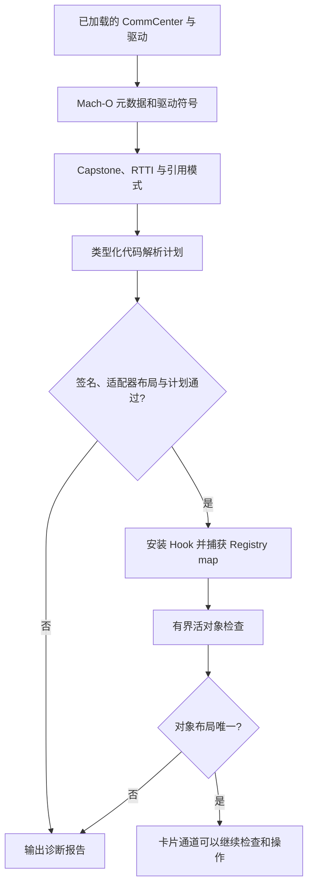

# Patchfinder 是怎么工作的

[English](PATCHFINDER.md) | **简体中文**

SIMHarbor 的 Patchfinder 用于定位 CommCenter 通道依赖的私有入口和对象字段。它结合已加载 Mach-O 的元数据、模块级符号、C++ RTTI、ARM64 指令和只读活对象检查，输出带有数值、依据和错误的解析计划；随后由 `Apdu.mm` 单独安装 Hook 和使用这些结果。

实现分为两部分：[RuntimeResolver.mm](../tweak/RuntimeResolver.mm) 负责 Darwin 运行时与活内存访问，[ResolverCore.cpp](../tweak/ResolverCore.cpp) 负责镜像分析和有界控制器搜索。[ResolverCore.hpp](../tweak/ResolverCore.hpp) 定义 `Image`、`Symbol` 和 `Plan` 数据结构。

传输调用流程、回调生命周期和状态迁移见 [CommCenter 内部通信文档](COMMCENTER_TRANSPORT.zh-CN.md)。

## 定位与运行时启用条件



是否启用由运行时证据决定，不使用机型、iOS 构建或 UUID 白名单。安装 Hook 前检查编译适配器布局、完整驱动签名、函数边界及完整且唯一的代码计划；操作卡片前还要通过活对象和卡槽校验。UUID 只标识诊断样本，“代码已解析”本身仍不代表卡片通道可用。

## 1. 描述已加载镜像

`SHResolveFirmware` 从 dyld 镜像列表找到 `CommCenter` 和 `libCommCenterMCommandDrivers.dylib`，读取：

- 实际加载基址、应用 slide 后的段/节范围，以及可执行节。
- `LC_UUID`，用于标识具体二进制构建，不是设备或用户标识。
- `LC_FUNCTION_STARTS`，将 ULEB128 编码的地址增量还原成函数入口列表。

镜像读取限定在记录的可读范围内；任意活对象读取则使用 `vm_read_overwrite`，并检查地址、长度和溢出。指针比较前去除 PAC 位；去掉 PAC 并不等于验证了指针或对象。之后真正调用入口时，通道代码会构造相应的已签名函数指针。

分析使用当前加载地址，因此可以跟随 ASLR。匹配失败时不会转用历史数值地址表。

## 2. 用模块级符号定位驱动锚点

`driverSymbols` 动态绑定 CoreSymbolication，为当前进程创建 symbolicator，然后取得驱动镜像对应的 symbol owner。它只枚举该模块，保留名称包含 `sendSimApdu`、地址位于驱动可执行范围且属于函数起点的符号。

核心进一步筛选 `subscriber::EURSimCommandDriver` 的反修饰名称，将 `sendSimApdu_start`、`sendSimApdu_command`、`sendSimApdu_close` 三个普通方法，与命令方法内的匿名 block 区分开来。start 和 close 锚点各自必须唯一；缺少独立 command 方法时使用下文的原生 continuation 路径。

三个具名入口还会比较完整的解修饰参数签名，包括槽位类型、vector 引用和回调/block 参数，比较时忽略空白差异。这些检查不等于证明私有 ABI 的所有细节。当前驱动依赖私有符号缓存，仅查导出表不能满足要求。生产路径不初始化 Gum 的全进程符号缓存，也不需要 GumJS 或 Frida server。

## 3. 解码指令并识别命令回调

ARM64 解码使用固定版本 Frida Gum devkit 中的 Capstone 5。初始化时显式注册 ARM64、配置 libc 内存函数并开启详细解码。通过 `cs_disasm_iter` 复用一个 Capstone 指令/详情对象，避免为整个函数分配 Capstone 详情数组；分析只按需保留解码后的记录。

`loads` 通过部分寄存器移动跟踪参数来源，记录选定的内存加载，并在遇到 `BL` 后清除调用者保存寄存器的来源。`refs` 还原部分 `ADR`/`ADRP` 加 `ADD` 的地址引用；小型 stub 识别器用于跟随支持的间接跳转，匹配导出的就绪判断函数。

卡槽遍历采用有界控制流／数据流分析，驱动引用和回调使用较窄的指令证据；这不是与编译器无关的符号执行引擎。当前函数解码要求存在下一个函数边界，且长度不超过 64 KiB。

匿名命令 block 由多项特征共同区分：

| 候选 | 当前规则使用的依据 |
|---|---|
| 编码回调 | 从第二个参数读取 vector 尾指针，并加载相邻字节捕获字段；允许一层受支持的直接辅助函数。 |
| 响应回调 | 从第二个参数读取 vector 范围指针对，存在字长槽位字段，以及符合相对布局的通道/指令字节字段。 |
| QMI 结果回调 | 从响应参数读取字长结果字段，并直接调用已定位的关闭方法。 |

加载指令中的 displacement 给出通道、槽位和错误字段偏移。规则仍约束捕获字段之间的相对布局，并不会自动支持任意字段重排。

## 4. 还原控制器、worker 和完成回调

RTTI 扫描识别具体的 `SubscriberSimController` 类型，以及 APDU 相关 libc++ 函数闭包。候选主虚表要求 offset-to-top 为零，且入口指向可执行区域；当前最多遍历 96 个虚表入口。

解析器遍历控制器虚方法，寻找对某个 worker 函数的 PC 相对引用；该 worker 还必须引用指定 APDU 任务的虚表。借助这一关系定位 sender 和 worker，不固定某个虚方法槽位。完成闭包的 invoke 函数则通过读取 bool 引用的指令模式识别。

worker 内还有两项推导：

- 导出的 `subscriber::isSimReady` 判断之前的那次调用，用于识别 SimInfo 状态读取函数。匹配就绪函数时会跟随支持的认证跳转 stub。
- 通过有界控制流／数据流分析，追踪 vector 边界、非空分支、逻辑槽相等路径和状态 getter 实参；从循环回边提取步长。游标直接作为对象代表内联存储，先加载指针则代表间接条目。每个起点最多分析 4096 个状态、向前 512 条指令；预算耗尽时拒绝解析。

关系示意：

```text
控制器虚方法 -> worker 引用 -> 指定 APDU 任务虚表
worker -> SimInfo 状态函数 -> 导出的就绪判断
worker -> vector 边界 -> 内联对象／间接条目 -> 逻辑槽字段
```

这些关系描述当前实现的规则，不代表所有编译器都会生成相同形式。

## 5. 不发送 APDU 的活对象检查

ABI 和代码计划通过后，扩展 Hook 导出的 Registry getter，在 CommCenter 自己调用时捕获服务 map 指针。getter 只捕获指针，有界搜索在后续单独执行。

`findController` 检查根部的 32 个机器字，沿可能的 next-pointer 链前进，限制每条链最多 512 步、总共访问最多 2,048 个节点。它读取有界节点字段，只接受一个与已解析控制器虚表一致的不同对象。这样去掉了原先固定的 map、节点值和 typeinfo 引用偏移，但仍假设服务 map 中存在这种可达指针链。

活对象读取通过 [RuntimeObjects.hpp](../tweak/RuntimeObjects.hpp) 中的 `MemoryReader`、`ControllerView`、`SimContainerView` 和 `SimInfoView` 完成。`SHMakeControllerView` 提供已发现的字段偏移和已发现的存储方式、条目步长和指针位移。视图只复制可平凡复制的快照，不把外部内存转换为拥有所有权的 STL 对象，也不修改引用计数。读取失败或边界无效时返回 `nullopt`。这些封装不会延长目标对象的生命周期、让并发修改具有原子性，或保证后续私有 getter 调用仍然安全。

`SHInferObjectLayout` 再推导两项字段：

1. **驱动成员位置：** 按指针对齐扫描控制器前 512 字节。指向对象的 RTTI 必须精确等于具体驱动类型 `N10subscriber19EURSimCommandDriverE`。shared-pointer 控制块的类型名也可能包含驱动类名，因此不能只做子串匹配。
2. **硬件槽字段：** 按已发现的条目步长及内联／间接存储方式读取已发现的 SimInfo vector；当前接受 1–16 个节点。扫描各对象前 128 字节中的对齐整数字段，排除逻辑槽字段，只接受一个在各节点间取不同值、且值域为 1–3 的候选字段。

这些字段关联是启发式规则，不能单独证明新设备的卡槽语义。初始化期间可能出现多个候选，此时通道拒绝使用该布局，等待之后重新检查。逻辑槽与硬件槽始终分别处理。

## 最终确定了什么

| 来源 | 结果项 |
|---|---|
| 驱动符号和 block 分析 | `driverStart`、`driverCommand`、`driverClose`、`encoder`、`response`、`qmi` |
| 驱动加载指令的位移 | `encoderChannel`、`responseSlot`、`responseChannel`、`qmiError` |
| RTTI、引用与 worker 指令 | `controllerVtable`、`sender`、`worker`、`completion`、`simState`、`simVector`、`logicalSlot` |
| 导出符号 | `isReady` |
| 活对象检查 | `driverMember`、`hardwareSlot` |

解析计划另含 `simStorage`（1 内联，2 间接）、`simEntryStride` 和 `simPointeeOffset`。命令被内联且没有方法符号时，使用 `commandContinuation` 替代 `driverCommand`。Registry getter 独立通过导出定位。

## 逐项说明：为什么要找、在哪里用、怎样找到

这里的“偏移”实际包含几种值：**函数地址**用于调用或 Hook；**虚表地址**用于识别对象或作为分析锚点；**成员偏移**需要加到特定对象或回调参数上，再读取字段。成员偏移不能加到镜像基址上。报告中的 `imageOffset` 是地址相对所属镜像的位移，便于跨 ASLR 比较；通道实际调用的是本次解析出的地址。`driverMember` 和 `hardwareSlot` 即使在报告中显示为整数，也仍然是字节偏移。

已实测镜像的具体数值见[发现结果示例](manual/zh-Hans/porting.md)，它们用于对照，不是下述算法的输入。使用位置在 [Apdu.mm](../tweak/Apdu.mm)，静态定位在 [ResolverCore.cpp](../tweak/ResolverCore.cpp) 的 `resolve`，活对象字段定位在 [RuntimeResolver.mm](../tweak/RuntimeResolver.mm) 的 `SHInferObjectLayout`。

### A. 驱动入口与回调地址：6 项

| 结果项 | 为什么需要／实际使用位置 | 怎样定位与检查 |
|---|---|---|
| `driverStart` | 基带没有报告 SIM 就绪时，直接打开 ISD-R，才能管理未激活的卡片或配置。`open` 分支传入活驱动、映射后的硬件槽、AID 和回调；打开回调返回分配的通道号。 | 枚举驱动模块的符号，选取非 block 的 `EURSimCommandDriver::sendSimApdu_start`，核对完整参数签名、驱动可执行范围和函数起点，并要求唯一地址。 |
| `driverCommand` | `commandHook` 在普通打开路径捕获驱动、通道和响应 vector 引用。之后 `transmit` 调用 `commandOrig`，在保留的通道上触发新一轮交换；真正的 App APDU 在编码回调中替换进去。 | 选取驱动内非 block 的 `sendSimApdu_command`，要求完整参数签名、可执行函数起点及地址唯一；其内部 block 是后续回调搜索范围。 |
| `driverClose` | `closeHook` 拦住匹配会话在打开／传输后自动关闭的动作，保留回调，使管理通道继续可用。显式 `closeSession` 调用 `closeOrig` 真正关闭通道并释放保留状态。 | 按完整参数签名查找非 block 的 `sendSimApdu_close`，要求唯一可执行函数起点。其地址也用于识别 QMI 回调中的直接关闭调用。 |
| `encoder` | `encodeHook` 先执行原编码回调，再在活动传输且通道匹配时，把生成的 vector 换成 App 等待发送的 APDU。这是用户字节进入调制解调器交换的位置；把原始 APDU 当成高层 sender 的 AID 传入不能实现这一功能。 | 在命令方法的匿名 block 中，找第二参数偏移 8 处的 vector 尾部指针对 `LDP`，要求唯一；随后还要通过 `encoderChannel` 使用的相邻字节捕获字段检查。 |
| `response` | `responseHook` 按活动硬件槽和通道筛选，复制包含 SW1/SW2 的原始响应 vector，交给 App，再调用原回调。 | 唯一候选必须同时具备第二参数偏移 0 处的 vector 范围指针对 `LDP`、正偏移的字长槽位捕获，以及下文要求的槽位／通道／指令相对布局。 |
| `qmi` | `qmiHook` 在活动传输时记录基带传输结果，再调用原回调。结果非零时，即使存在部分响应字节，通道仍报告传输失败。 | 找到唯一命令 block：从响应参数前 32 字节内读取字长结果，并直接调用已定位的 `driverClose`；提取字段时还要求响应参数的正字长加载位移唯一。 |

### B. 控制器与会话地址：6 项

| 结果项 | 为什么需要／实际使用位置 | 怎样定位与检查 |
|---|---|---|
| `controllerVtable` | 这是数据地址，不是某个虚方法的槽位偏移。`findController` 用它与候选对象的 vptr 比较，找到唯一的活 `SubscriberSimController`；其入口也提供 `sender` 的搜索范围。 | 找到精确类型名 `23SubscriberSimController` 的 RTTI，跟随引用寻找 offset-to-top 为零、入口可执行的主虚表，并要求唯一。保存的是对象 vptr 使用的虚表地址点。 |
| `sender` | 普通 `open` 路径调用这个控制器方法，传入**逻辑槽**、共享 AID／输出 vector。它发起高层交换，使 Hook 能捕获并保留驱动、通道和 vector。 | 遍历控制器虚表方法，寻找支持的 PC 相对 worker 引用；worker 必须是可执行函数起点，并引用已识别的 APDU 任务虚表。sender 和 worker 均须去重后唯一，不固定虚方法索引。 |
| `worker` | 这是分析锚点，通道**不会直接调用或 Hook 它**。通过其函数体把 sender 与 APDU 任务关联起来，并推导状态 getter 和 SimInfo 字段。 | 找到唯一的“控制器方法 → worker → APDU 任务虚表”引用链，worker 必须是 CommCenter 内的函数起点。 |
| `completion` | `completionHook` 在调用原函数后观察高层任务结束，配合阶段状态和信号量释放关闭等待，或报告打开失败。直接打开路径另有自己的保留回调。 | 通过 RTTI 找到 APDU 的 bool 完成闭包，检查其虚表入口，选取唯一含“读取第二参数所指 bool”的字节加载模式的函数，模式为 `LDRB wN, [x1]`；目标为编译器分配的通用寄存器（例如 w1 或 w8），参数基址和字节位移仍受约束。入口由指令推导，不固定 invoke 槽位。 |
| `simState` | `slotInfo` 在选中的 `SimInfo` 上调用此 getter，再把结果交给 `isReady`，决定使用普通 sender 还是直接驱动打开路径。 | 在 worker 中找到目标经支持的 stub 还原后等于就绪判断导出的 `BL`；它前一条直接调用的目标必须可执行且唯一，该目标就是状态 getter。 |
| `isReady` | 解释基带／SIM 状态，避免写死“某个状态枚举值等于就绪”。它决定 SIM 能否走普通路径，不是 profile 列表中的启用状态。 | 使用 `dlsym` 查找 `_ZN10subscriber10isSimReadyENS_8SimStateE`，作为 worker 调用链锚点；比较目标时跟随支持的 stub。缺少导出会使计划不完整。 |

### C. 从指令推导的字段：6 个字节偏移

| 结果项／相对哪个对象 | 为什么需要／实际使用位置 | 怎样定位与检查 |
|---|---|---|
| `encoderChannel`／编码 block `b` | `encodeHook` 从 `b + encoderChannel` 读取一个字节，只有活动通道匹配时才替换待发送 APDU。 | 在已识别编码 block 的参数来源追踪结果中收集正字节位移，要求恰好两个不同且连续的位移，取较小者为通道字段。旁边的指令字节只是校验伴随项，不单独输出一个结果。 |
| `responseSlot`／响应 block `b` | `responseHook` 从 `b + responseSlot` 读取整数，与活动**硬件槽**比较，通过后才考虑复制响应。 | 收集响应 block 第一参数的正字长加载位移，要求唯一，再与两个字节捕获字段一起校验。 |
| `responseChannel`／响应 block `b` | 响应 Hook 再检查此处的通道字节，避免仅因槽位相同就复制其他通道的响应。 | 响应 block 恰好有两个不同的字节位移；较小者必须等于 `responseSlot + 4`，另一项必须紧随其后。取较小者为通道字段；该规则不能适应任意捕获字段重排。 |
| `qmiError`／QMI 结果参数 `r` | `qmiHook` 从 `r + qmiError` 读取整数，供 `transmit` 判断基带传输结果。它相对**回调的第二参数**，不是相对 block 对象。 | 识别 `qmi` 后，检查追踪到的参数 1 加载，要求唯一的正字长位移；回调分类还要求存在前 32 字节内的结果字加载以及关闭调用。 |
| `simVector`／控制器 `iface` | `slotInfo` 和 `SHInferObjectLayout` 在 `iface + simVector` 读取 vector 的 begin/end，再按发现的内联／间接条目遍历 `SimInfo`。这是容器成员的位置，不是第一个 SIM 对象的地址。 | 寻找正偏移、非栈基址的边界对加载，验证非空循环分支、逻辑槽相等路径及状态 getter 的对象身份；从回边推导步长。运行时核对边界、描述符范围及 1–16 个条目，收集对象地址后再次核对边界。 |
| `logicalSlot`／某个 `SimInfo` | `slotInfo` 读取此整数，选出与 App 逻辑槽请求对应的节点；之后才读取该节点的硬件槽字段，交给驱动。 | 从已验证的相等路径取得字加载位移，并关联到状态 getter 的对象实参。内联字段必须处于条目范围内；零偏移合法，不表示发现失败。 |
| `simStorage`／容器描述符 | 让 `SimContainerView` 选择内联地址或间接指针读取；1／2 是存储方式，不是字节偏移。 | 追踪状态 getter 的对象来自循环游标，还是条目内加载的指针；歧义时拒绝。 |
| `simEntryStride`／容器描述符 | 遍历条目并限制内联字段范围，不依赖扩展编译时的 STL 大小。 | 从通向边界比较的回边恢复游标增量，要求唯一、正值、对齐且未超过分析上限。 |
| `simPointeeOffset`／间接条目 | 按条目内偏移读取对象指针，不访问拥有所有权的 shared-pointer 控制块。 | 追踪传给状态 getter 的指针加载，要求指针字位于步长范围内；零偏移合法。 |
| `commandContinuation`／原生 block invoke | 复用前核对复制的打开成功 block，绝不转换成旧命令方法签名调用。 | 精确的命令回调所属签名、多个回调引用，以及调用已验证 `driverStart` 的上层函数；运行时再次核对实际 invoke 指针。 |

### D. 从活对象推导的字段：2 个字节偏移

| 结果项／相对哪个对象 | 为什么需要／实际使用位置 | 怎样定位与检查 |
|---|---|---|
| `driverMember`／控制器 `iface` | SIM 未就绪时，直接打开路径从 `iface + driverMember` 读取驱动指针，再调用 `driverStart`。普通 sender 路径则从 `commandHook` 捕获驱动。 | 从控制器 vptr 后开始，按指针对齐扫描前 512 字节；跟随可读对象的 vptr/typeinfo/name，要求恰好一个精确 RTTI 为 `N10subscriber19EURSimCommandDriverE` 的对象。精确匹配排除 shared-pointer 控制块。保存成员位移，不保存本次驱动地址作为常量。 |
| `hardwareSlot`／某个 `SimInfo` | 把选中逻辑 SIM 节点映射成驱动的硬件槽。驱动打开／发送／关闭及响应槽位匹配使用这个值，它不一定等于 App 的逻辑编号。 | 从已发现的 SimInfo vector 取节点，在各对象前 128 字节扫描对齐整数字段，排除 `logicalSlot`；要求候选字段在各节点中取值为 1–3 且互不相同，并且字段候选唯一。这是相关性启发式；存在歧义或不可读数据时不使用该布局。 |

选择路径可以概括如下；这是现有读取过程的关系说明，不是可直接运行的独立 API：

```text
registryMap -> findController(controllerVtable) -> iface
iface + simVector -> shared-pointer 条目 -> SimInfo
SimInfo + logicalSlot -> 选出请求的逻辑节点
SimInfo + hardwareSlot -> 驱动使用的硬件槽值
isReady(simState(SimInfo)) -> 普通 sender 或直接 driverStart 路径
iface + driverMember -> 直接路径所需的驱动指针
```

`qmiError`、APDU 的 SW1/SW2、解码后的 ES10b 安装 `errorReason` 是不同层次的错误。定位基带结果字段，不等于找到一个“配置已安装”的标记；安装结果由 LPA/libeuicc 层解码。

### E. 不计入上述 20 项的导出与临时锚点

| 锚点 | 用途 | 定位／处理方式 |
|---|---|---|
| `getter` | Hook Registry 的服务 map getter，捕获 CommCenter 正常使用时的返回指针，为活控制器搜索提供根，不需要固定 Registry 成员偏移。 | 尝试 `_ZNK8Registry13getServiceMapEv`，按实际所属加载镜像验证可执行范围及函数起点或精确导出边界；不存在或无效时使用验证通过的 mutable getter。所属镜像通过 `registryImage` 报告，不要求一定属于 CommCenter 主程序。 |
| `mutableGetter` | 非 const 重载独立存在且地址不同时，也通过它捕获同一个 map；至少一个 getter 验证通过即可。 | 查找 `_ZN8Registry13getServiceMapEv` 并在其实际镜像内验证；只有与最终选择的 `getter` 不同时才单独安装 Hook。 |
| APDU 任务虚表 | 把未具名 worker 与目标操作关联起来，是分析锚点，不是通道直接调用的入口，也不是固定对象偏移。 | RTTI 限定在包含 `sendSimSingleApduCommand_sync` 的 APDU 闭包中，选取带 `Fvv` 的非嵌套 `__funcIZN…` 形式，要求唯一，再匹配 worker 对该虚表的引用。 |
| bool 完成闭包虚表 | 将 `completion` 的搜索范围限定到相关回调实现。 | 在同一个 APDU RTTI 家族中，选取嵌套 `__funcIZZN…` 形式并要求唯一，再在其虚表入口中应用 bool 引用加载规则。 |

`registryMap`、`iface`、`driver`、通道号、`responseVector` 和保留的回调，都是运行时捕获或读取的活句柄，不是额外的可移植数值偏移。旧的 map／节点值／typeinfo 引用偏移，以及固定控制器／invoke 虚表索引，已不再是配置输入；它们由有界遍历、RTTI 和代码引用取代。

## 失败处理与诊断

核心的 `only` 辅助函数会去重，并要求恰好一个不同的候选值。锚点缺失、候选歧义、捕获布局不兼容或解码失败都会留下不完整计划和明确错误；不会猜测数值偏移。预期的匹配失败显式返回状态或错误，不依赖 C++ 异常展开。

固件报告包含 UUID、`compiledAbiCompatible`、`signaturesValidated`、`abiCompatible`、`hookStage`、`codeResolved`、`objectLayoutResolved`、各项依据、候选数量和错误。`analysisMilliseconds` 测量静态解析阶段；`maxMeasuredFootprintBytes` 是若干阶段采样的最大值，不是连续测得的内存峰值。

模块级符号查询和迭代解码减少 CommCenter 中的临时内存占用。早期全进程枚举曾超出该进程的内存预算，因此生产实现已移除这种路径。

## 移植与验证

从 1.3.14 起，驱动打开/发送/关闭符号还必须匹配完整解修饰参数签名，包括槽位类型、vector 引用、回调/block 参数和 libc++ 命名空间；比较时忽略空白差异，仅匹配方法名不够。Registry getter 按实际所属加载镜像验证，要求位于可执行段且命中函数起点或精确导出符号边界；`registryImage` 表示所属镜像。`hookStage` 的 0 表示尚未安装、1 表示正在安装、2 表示必需的原始函数指针均已取得、3 表示失败。活对象诊断会说明还缺少哪一环。

[shared/Firmware.h](../shared/Firmware.h) 只检查编译后的 ARM64 适配器布局，不检查固件身份。驱动完整解修饰签名与适配器接口形状比较，Capstone 和活对象检查补充证据；无需登记 UUID。这属于兼容性推断，不是对私有调用约定、回调生命周期或卡槽语义的形式化证明。

符号变化、RTTI 裁剪、编译器输出改变、函数过大、服务 map 形态变化、SimInfo 或槽位字段不唯一，都可能需要扩展规则。应保留歧义拒绝机制，补充镜像回放和反例，并确认旧构建回归通过后再宣称新目标已经验证。

[tests/test_resolver.cpp](../tests/test_resolver.cpp) 使用授权采集的镜像测试已知结果、ASLR 重定位、符号缺失/歧义/非入口地址、不可读镜像及循环/歧义对象链。镜像属于私有资料，不进入 Git 和 CI。该回放不覆盖 Darwin 符号查询、全部活布局启发式、Hook 执行或完整 profile 管理，这些还需要单独真机检查。另见[移植说明](ARCHITECTURE_PORTING.zh-CN.md)和[验证范围](VALIDATION.zh-CN.md)。

本文仅保留在仓库。App 只打包双语使用说明，固件报告仍作为独立诊断工具提供。

卡槽管理跳过未分配的 SimInfo 节点（逻辑编号 ≤ 0），保留已分配但未就绪的节点。占位节点仍参与布局发现，不应硬编码排除某个硬件编号；逻辑编号也不固定为 1/2。路由、EID 保护和验证范围见[多卡槽文档](MULTI_SLOT.zh-CN.md)。

### 自适应布局与原生 continuation（1.3.22）

目前已收集的六个样本（16.5.1、17.2.1、17.6、18.0、18.6、26.0.1）均可通过文件模型静态重放。16.5.1 样本推导出内联存储、成员 `+0xf8`、步长 `0x138`、逻辑字段 `+0x4`；其余样本为间接条目、成员 `+0xa8`、步长 `0x10`、逻辑字段 `+0x24`。这些都是分析结果，不是按版本选择的常量。就绪判断始终调用目标的导出函数，不复制其状态枚举或位掩码。

18.0、18.6 和 26.0.1 样本将命令构造内联到原生“打开成功”block。没有命令方法符号时，要求命令回调所属函数签名完全匹配、某一入口引用多个不同命令回调，且引用该入口的调用者同时调用已验证的 start 方法。结果写入 `commandContinuation`。运行时 `startHook` 核对实际 block 的 invoke 指针，再复制原生 Objective-C block 以保留其真实捕获对象，同时记录分配的通道。后续交换以硬件槽／通道调用这个 block，绝不套用已消失的方法 ABI；显式关闭完成后释放 block。

当前 continuation 适配器需要 SIM 就绪，控制器才能创建该原生 block。未就绪时在开通道前拒绝；这一限制仍需进一步适配。存在独立命令方法的固件保留直接访问未就绪槽位的路径。26.0.1 的 vector 尾指针和字节捕获证据可跨一层直接辅助函数追踪，不递归分析。

静态重放不执行目标代码，也不证明能完成配置管理。运行时符号化、hook 和卡片通信仍需真机验证；六个样本不覆盖 iOS 14–26.0.1 的所有设备／构建。未知、歧义布局继续输出诊断。[主机重放工具](../research/firmware/README.zh-CN.md#file-model-resolver-replay)和[合成遍历测试](../tests/test_sim_container.cpp)用于后续验证。

活对象硬件槽字段允许位于偏移零；是否完成定位由显式的对象发现状态决定，不将零偏移误认为缺失。
